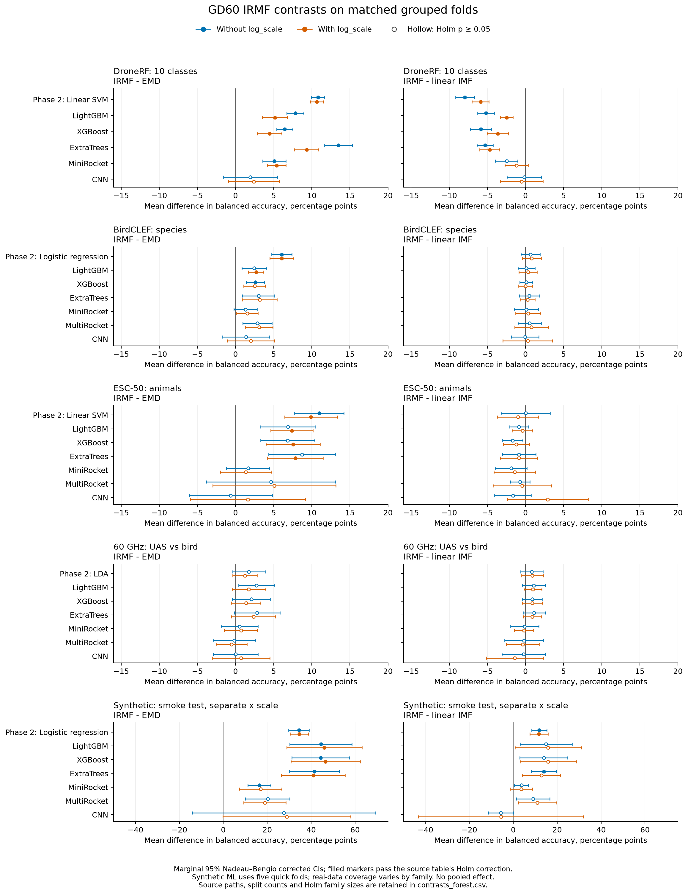

# EMD, IMF and IRMF for classification

+10.80 pp on [DroneRF](dronerf/classical/paired_all_metrics.csv), +6.05 pp on [BirdCLEF](birdclef2023/classical/paired_all_metrics.csv) and +10.97 pp on [ESC-50 animals](esc50_animals/classical/paired_all_metrics.csv) are the classical fixed-model IRMF gains over EMD without `log_scale`. All survive their source Holm corrections. LightGBM reduces those gains to [+7.84](dronerf/ml/paired_requested.csv), [+2.44](birdclef2023/ml/paired_all_metrics_species.csv) and [+6.86 pp](esc50_animals/ml/paired_requested.csv); only DroneRF retains Holm significance without level. [Radar](uas_birds_60ghz/ml/REPORT.md) remains inconclusive. Linear IMF remains competitive or better.

## Question and design in five lines

1. Does a robust multiscale decomposition improve classification over EMD, linear IMF and normalized raw frames? [Protocol](../../experiments/classification-emd-irmf/PROTOCOL.md).
2. Primary real tasks are DroneRF 10-class, BirdCLEF 16-species, ESC-50 10-animal and public 60 GHz UAS/bird; synthetic is a pipeline and contamination control. [Dataset notes](../../experiments/classification-emd-irmf/README.md#data).
3. Frames are 2,048 samples for RF/audio and 1,000 for radar; median/MAD normalization precedes shared component statistics or component-stack models. [Protocol](../../experiments/classification-emd-irmf/PROTOCOL.md).
4. Five grouped folds × three seeds hold out segments, recordists, uploaders or target-plus-pose groups; some stack-model budgets use fewer seeds. All fitting and tuning use training data. [Classical summary](SUMMARY_classical.md), [ML reports](#dataset-reports).
5. Paired fold differences use Nadeau-Bengio corrected 95% intervals and t-tests with Holm correction; Wilcoxon is secondary. Every contrast runs without and with shared `log_scale`. [Protocol](../../experiments/classification-emd-irmf/PROTOCOL.md).

## Best observed frame balanced accuracy

Percent BA without `log_scale`. C is the best available classical model, M the best ML model, selected separately for each input. These outer-CV maxima are exploratory, not paired superiority tests. Main classical inputs have six families; converged IRMF has only LDA, logistic regression and linear SVM. Synthetic ML uses five quick folds, classical uses all fifteen; converged synthetic classification was not run. Raw-STFT references are outside this frame/component comparison. Source CSVs are linked in each row. [Coverage and budgets](#dataset-reports).

| Dataset; source CSVs | Raw | EMD | Linear IMF | IRMF GD60 | IRMF conv |
|---|---|---|---|---|---|
| DroneRF [classical][dr_c], [conv][dr_a], [ML][dr_m] | C: 41.94 kNN M: 57.20 ExtraTrees | C: 38.78 Logistic regression M: 56.49 LightGBM | C: 57.47 Linear SVM M: 69.51 LightGBM | C: 49.53 Linear SVM M: 64.34 LightGBM | C: 50.36 Linear SVM M: 64.68 LightGBM |
| BirdCLEF [classical][bc_c], [conv][bc_a], [ML][bc_m] | C: 42.33 kNN M: 52.63 CNN | C: 43.45 Logistic regression M: 51.23 CNN | C: 49.29 Linear SVM M: 52.80 LightGBM | C: 49.56 Linear SVM M: 52.93 LightGBM | C: 49.57 Logistic regression M: 53.05 LightGBM |
| ESC-50 animals [classical][es_c], [conv][es_a], [ML][es_m] | C: 49.98 kNN M: 56.49 MiniRocket | C: 54.32 Linear SVM M: 59.46 LightGBM | C: 65.27 Linear SVM M: 67.18 LightGBM | C: 65.29 Linear SVM M: 66.32 LightGBM | C: 65.29 Logistic regression M: 65.89 LightGBM |
| 60 GHz radar [classical][ua_c], [conv][ua_a], [ML][ua_m] | C: 96.53 Linear SVM M: 96.20 MiniRocket | C: 97.60 Linear SVM M: 96.80 MiniRocket | C: 98.48 LDA M: 97.99 XGBoost | C: 99.32 LDA M: 98.98 LightGBM | C: 99.14 LDA M: 99.11 LightGBM |
| Synthetic smoke test [classical][sy_c], [trees][sy_trees], [rocket][sy_rocket], [cnn][sy_cnn] | C: 47.44 Logistic regression M: 57.20 CNN | C: 50.53 Linear SVM M: 41.60 MiniRocket | C: 74.93 LDA M: 70.13 LightGBM | C: 86.87 LDA M: 85.07 LightGBM | C: not run M: not run |

## Paired contrasts with classifiers held fixed

Each cell is mean Δ BA in percentage points [95% corrected CI]; Holm p. IRMF means default H=2, a=√2, GD60 throughout. The real-data phase-2 reporting classifiers are linear SVM, logistic regression, linear SVM and LDA in dataset order. Synthetic uses logistic regression, selected descriptively by mean phase-2 BA across the main inputs and both scale settings. None changes by contrast. Best-model cells above can therefore differ from these fixed-model scores.

The original classical CSV families contain 72 tests per task/metric, except radar's fixed-LDA family of 12. Main ML families contain 100 tests for DroneRF/ESC-50 and 120 for BirdCLEF/radar. Synthetic ML uses runner-specific families of 36 tree tests, 24 ROCKET tests and 12 CNN tests. These counts and each source filename are also in the [plot CSV](figures/contrasts_forest.csv). CIs are marginal; a CI excluding zero can coexist with Holm p above .05. This synthesis preserves stored tests and does not pool datasets or recalculate p-values.

### Without log_scale

| Dataset / fixed model; source CSV | IRMF − EMD | IRMF − linear IMF | Linear IMF − EMD | IRMF − raw |
|---|---|---|---|---|
| DroneRF / Linear SVM [CSV](dronerf/classical/paired_all_metrics.csv) | +10.80 [+9.91, +11.69]; 2.01e-11 | -7.94 [-9.17, -6.72]; 5.85e-08 | +18.74 [+17.05, +20.43]; 6.38e-11 | +14.58 [+12.98, +16.18]; 8.01e-10 |
| DroneRF / LightGBM [CSV](dronerf/ml/paired_requested.csv) | +7.84 [+6.73, +8.96]; 4.31e-08 | -5.17 [-6.27, -4.08]; 5.88e-06 | +13.02 [+11.15, +14.89]; 5.08e-08 | +7.29 [+5.63, +8.96]; 1.48e-05 |
| BirdCLEF / Logistic regression [CSV](birdclef2023/classical/paired_all_metrics.csv) | +6.05 [+4.72, +7.39]; 6.65e-06 | +0.65 [-0.60, +1.89]; 1 | +5.41 [+4.24, +6.57]; 5.42e-06 | +11.89 [+9.84, +13.94]; 3.83e-07 |
| BirdCLEF / LightGBM [CSV](birdclef2023/ml/paired_all_metrics_species.csv) | +2.44 [+0.82, +4.06]; 0.502 | +0.13 [-1.00, +1.26]; 1 | +2.31 [+0.66, +3.95]; 0.72 | +6.09 [+4.64, +7.54]; 3.89e-05 |
| ESC-50 animals / Linear SVM [CSV](esc50_animals/classical/paired_all_metrics.csv) | +10.97 [+7.75, +14.19]; 0.000218 | +0.02 [-3.21, +3.24]; 1 | +10.95 [+7.71, +14.19]; 0.000231 | +20.95 [+14.36, +27.54]; 0.000426 |
| ESC-50 animals / LightGBM [CSV](esc50_animals/ml/paired_requested.csv) | +6.86 [+3.30, +10.42]; 0.0666 | -0.86 [-2.06, +0.34]; 1 | +7.72 [+4.57, +10.87]; 0.00914 | +13.95 [+8.55, +19.35]; 0.00581 |
| 60 GHz radar / LDA [CSV](uas_birds_60ghz/classical/paired_frame_lda_bird_drone.csv) | +1.75 [-0.38, +3.88]; 1 | +0.83 [-0.63, +2.30]; 1 | +0.92 [-0.73, +2.56]; 1 | +4.03 [-0.30, +8.37]; 0.787 |
| 60 GHz radar / LightGBM [CSV](uas_birds_60ghz/ml/paired_requested.csv) | +2.75 [+0.40, +5.11]; 1 | +1.09 [-0.42, +2.60]; 1 | +1.66 [-0.96, +4.29]; 1 | +3.06 [-0.02, +6.13]; 1 |
| Synthetic smoke test / Logistic regression [CSV](synthetic/classical/comparisons_signal.csv) | +34.42 [+29.73, +39.12]; 1.88e-08 | +11.82 [+8.35, +15.30]; 0.000142 | +22.60 [+17.48, +27.72]; 8.36e-06 | +37.40 [+32.22, +42.58]; 2.19e-08 |
| Synthetic smoke test / LightGBM [CSV](synthetic/ml/trees/comparisons_signal.csv) | +44.40 [+30.21, +58.59]; 0.0242 | +14.93 [+3.09, +26.77]; 0.243 | +29.47 [+17.60, +41.33]; 0.0348 | +51.40 [+39.11, +63.69]; 0.0101 |

### With log_scale

| Dataset / fixed model; source CSV | IRMF − EMD | IRMF − linear IMF | Linear IMF − EMD | IRMF − raw |
|---|---|---|---|---|
| DroneRF / Linear SVM [CSV](dronerf/classical/paired_all_metrics.csv) | +10.67 [+9.80, +11.53]; 1.63e-11 | -5.90 [-7.01, -4.80]; 6.32e-07 | +16.57 [+15.30, +17.84]; 7.46e-12 | +14.54 [+13.16, +15.91]; 1.2e-10 |
| DroneRF / LightGBM [CSV](dronerf/ml/paired_requested.csv) | +5.18 [+3.54, +6.82]; 0.000537 | -2.47 [-3.27, -1.66]; 0.00075 | +7.64 [+6.05, +9.24]; 5.2e-06 | +4.55 [+3.23, +5.87]; 0.000228 |
| BirdCLEF / Logistic regression [CSV](birdclef2023/classical/paired_all_metrics.csv) | +6.05 [+4.49, +7.60]; 3.84e-05 | +0.82 [-0.41, +2.05]; 1 | +5.23 [+4.02, +6.44]; 1.13e-05 | +11.82 [+9.98, +13.66]; 1.05e-07 |
| BirdCLEF / LightGBM [CSV](birdclef2023/ml/paired_all_metrics_species.csv) | +2.70 [+1.70, +3.69]; 0.00488 | +0.35 [-0.84, +1.53]; 1 | +2.35 [+0.90, +3.80]; 0.308 | +6.79 [+5.45, +8.14]; 4.12e-06 |
| ESC-50 animals / Linear SVM [CSV](esc50_animals/classical/paired_all_metrics.csv) | +9.89 [+6.44, +13.35]; 0.00115 | -1.00 [-3.66, +1.67]; 1 | +10.89 [+8.22, +13.55]; 3.1e-05 | +20.53 [+12.43, +28.62]; 0.00359 |
| ESC-50 animals / LightGBM [CSV](esc50_animals/ml/paired_requested.csv) | +7.39 [+4.63, +10.15]; 0.00421 | -0.40 [-1.74, +0.94]; 1 | +7.79 [+5.31, +10.27]; 0.000887 | +13.50 [+8.17, +18.83]; 0.00698 |
| 60 GHz radar / LDA [CSV](uas_birds_60ghz/classical/paired_frame_lda_bird_drone.csv) | +1.23 [-0.37, +2.82]; 1 | +0.91 [-0.52, +2.34]; 1 | +0.32 [-1.00, +1.63]; 1 | +2.20 [-0.62, +5.03]; 1 |
| 60 GHz radar / LightGBM [CSV](uas_birds_60ghz/ml/paired_requested.csv) | +1.75 [-0.45, +3.96]; 1 | +0.97 [-0.20, +2.14]; 1 | +0.78 [-1.49, +3.06]; 1 | +1.88 [-1.23, +4.99]; 1 |
| Synthetic smoke test / Logistic regression [CSV](synthetic/classical/comparisons_signal.csv) | +34.62 [+30.41, +38.83]; 4.09e-09 | +11.69 [+7.57, +15.81]; 0.000812 | +22.93 [+17.73, +28.14]; 8.41e-06 | +38.60 [+34.29, +42.91]; 1.36e-09 |
| Synthetic smoke test / LightGBM [CSV](synthetic/ml/trees/comparisons_signal.csv) | +46.00 [+28.86, +63.14]; 0.031 | +15.87 [+0.81, +30.92]; 0.301 | +30.13 [+18.43, +41.84]; 0.0324 | +55.60 [+35.02, +76.18]; 0.031 |

The [figure values](figures/contrasts_forest.csv) include every completed main model family and both scale settings. The synthetic row has a wider x scale and smoke-test budgets. Rebuild with [plot_contrasts.py](../../experiments/classification-emd-irmf/plot_contrasts.py).

## What the experiments establish

- **IRMF versus EMD.** The real-data classical gain survives removing level on DroneRF, BirdCLEF species and ESC-50 animals. It appears under all six classical families for the two audio primary tasks; DroneRF has a QDA reversal. LightGBM confirms DroneRF with either scale setting, but BirdCLEF and ESC-50 GD60 pass Holm only with level. BirdCLEF XGBoost passes without level; ESC-50 converged LightGBM/XGBoost also pass without level. Thus the mean ordering often survives classifier changes, while significance does not. Radar establishes no BA gain. [DroneRF classical](dronerf/classical/REPORT.md), [BirdCLEF classical](birdclef2023/classical/REPORT.md), [ESC-50 classical](esc50_animals/classical/REPORT.md), [ML reports](#dataset-reports).
- **IRMF versus linear IMF.** There is no consistent robustness-specific advantage on real data. DroneRF favors linear IMF by 7.94 pp with classical SVM and 5.17 pp with LightGBM without level. BirdCLEF's GD60 kNN exception is +2.53/+2.62 pp without/with level, significant in the original classical family; the later convergence ablations omit kNN. Synthetic does favor IRMF over linear IMF, but its designed contamination and short quick ML runs do not establish a real-data benefit. [DroneRF tests](dronerf/classical/paired_all_metrics.csv), [BirdCLEF report](birdclef2023/classical/REPORT.md), [synthetic tests](synthetic/classical/comparisons_signal.csv).
- **Convergence.** No consistent corrected accuracy gain is established by Newton versus GD60. The primary fixed-classifier changes without level are +0.83 pp DroneRF, +0.07 BirdCLEF, −0.31 ESC-50 and −0.17 radar; none survives the cross-study Holm correction. Newton does make solving much cheaper, roughly 20× in these caches, with actual ratios below. It solves the same lookup objective and all integrated channel-stages converge. [Classical ablation summary](SUMMARY_classical.md), [integration](../../experiments/classification-emd-irmf/irmf_solver/INTEGRATION.md).
- **Component count.** Extra slots alone do not explain the EMD gap. At a=2, converged IRMF−EMD remains +9.66 pp DroneRF, +4.43 BirdCLEF and +11.00 ESC-50 without level, all surviving the cross-study correction. Radar remains inconclusive. EMD has nine slots; a=2 gives ten on the RF/audio frames and nine on radar. The schedule changes too, so this is a partial control. The separate nine-slot audio LightGBM checks also retain most of the mean gap. [Classical summary](SUMMARY_classical.md), [BirdCLEF feature checks](birdclef2023/ml/REPORT.md), [ESC-50 ablations](esc50_animals/ml/ABLATIONS.md).
- **H and model family.** H=1/2/4 has little supported effect on audio/radar; DroneRF is sensitive, and the weaker robustness of H=4 moves it toward linear IMF without closing the gap. Among the broad cross-study corrections, DroneRF H1−H4 is −3.84 pp without level, Holm p=.0213. Trees benefit most from IMF features. ROCKET/CNN advantages are smaller or unsupported in the audio/radar studies; raw BirdCLEF CNN is competitive. DroneRF MiniRocket is an exception, IRMF−EMD +5.08/+5.40 pp with primary corrected-test support, though secondary Wilcoxon does not pass Holm. [Classical summary](SUMMARY_classical.md), [BirdCLEF ML](birdclef2023/ml/REPORT.md), [DroneRF ML](dronerf/ml/REPORT.md), [ESC-50 ML](esc50_animals/ml/REPORT.md), [radar ML](uas_birds_60ghz/ml/REPORT.md).

### Decomposition cost

Cached CPU seconds per complete frame, including both channels for DroneRF/radar, excluding feature extraction and fitting. Ratios are calculated from the linked CSVs. Historical concurrent runs are not an isolated speed benchmark. Raw has no decomposition cost.

| Dataset; source CSV | EMD | Linear IMF | GD60 IRMF | Newton IRMF | GD60 / Newton |
|---|---:|---:|---:|---:|---:|
| DroneRF; [CSV](dronerf/ml/decomposition_costs.csv) | 0.0294 | 0.0126 | 1.2787 | 0.1076 | 11.9× |
| BirdCLEF; [CSV](birdclef2023/ml/decomposition_costs.csv) | 0.0116 | 0.0063 | 1.3205 | 0.0579 | 22.8× |
| ESC-50 animals; [CSV](esc50_animals/ml/decomposition_costs.csv) | 0.0140 | 0.0062 | 1.7586 | 0.0644 | 27.3× |
| 60 GHz radar; [CSV](uas_birds_60ghz/ml/decomposition_costs.csv) | 0.0305 | 0.0044 | 0.3547 | 0.0314 | 11.3× |

## Limits and report differences

Audio labels describe recordings/clips, not verified events in every short frame. DroneRF still shares one BUI session between train and test; its nonsimultaneous L/H views, gating, SNR and quantization can carry acquisition information. Radar has only 49 recordings in 45 groups from one indoor campaign, using a bionic bird; its PRF is unverified. Its LightGBM IRMF−EMD 80%-power detectable difference is 6.18 pp at the conservative first Holm step, larger than the observed mean gain. Probability-averaged radar recording BA reaches 100% for all main inputs. None of this establishes equality or new-session accuracy. [Dataset notes](../../experiments/classification-emd-irmf/README.md#data), [radar power](uas_birds_60ghz/ml/POWER.md), [radar report](uas_birds_60ghz/ml/REPORT.md).

These scores cannot be ranked against published random-window protocols that share recordings across folds, or against full BirdCLEF soundscape systems. Context, tasks and feature budgets differ. The ML comparisons are fixed, restricted budgets, not accuracy ceilings; all primary DroneRF boosting fits hit their round cap. [Literature](../../experiments/classification-emd-irmf/LITERATURE.md), [DroneRF methods](dronerf/ml/RUN_NOTES.md), [BirdCLEF methods](birdclef2023/ml/REPRODUCE.md).

The pimf GD60 default is not generally a converged M-estimator. Frames with any capped stage are 16.642% on DroneRF, 34.267% on BirdCLEF, 55.020% on ESC-50 and 65.600% on synthetic. Exact reconstruction still holds because the residual absorbs fitting error. Solver error varies by class and can become a feature. Raising the GD cap alone is not a reliable convergence guarantee. [Committed solver audit](../../experiments/classification-emd-irmf/irmf_solver/REPORT.md).

The sources differ in scope and date:

- Original phase-2 reports, dataset ablations and `SUMMARY_classical.md` use different Holm families. For ESC-50 SVM IRMF−EMD without level, Holm p is .000218 in the original report, 8.96e−5 in the fixed-ablation table and .000347 in the cross-study summary, with the same +10.97 pp effect. The tables here use original phase-2 CSV corrections. [Original](esc50_animals/classical/REPORT.md), [ablation](esc50_animals/classical_ablations/REPORT.md), [cross-study](SUMMARY_classical.md).
- ESC-50's initial report says ablations were skipped, radar's initial report says convergence classification was not performed, and the first solver report calls `_conv` integration future work. Later ablation/ML reports and `INTEGRATION.md` supersede those readiness statements. Historical reports are preserved. [ESC-50 notes](esc50_animals/classical/RUN_NOTES.md), [radar classical](uas_birds_60ghz/classical/REPORT.md), [integration](../../experiments/classification-emd-irmf/irmf_solver/INTEGRATION.md).
- Radar phase-3 notes say pose-group correction is used "as in" phase 2. The phase-2 **frame** CSV actually stores frame-count ratios; its recording tables use groups. Phase 3 uses pose-group ratios. This synthesis keeps each saved CI rather than silently harmonizing them. [Phase-2 frame CSV](uas_birds_60ghz/classical/paired_frame_lda_bird_drone.csv), [phase-3 notes](uas_birds_60ghz/ml/RUN_NOTES.md).
- Preliminary solver timings and planning estimates differ from completed full-cache measurements. The cost table above uses the latter. Best-of-family summaries also differ from fixed-classifier tests by design, not because the scores changed. [Solver audit](../../experiments/classification-emd-irmf/irmf_solver/REPORT.md), [integration](../../experiments/classification-emd-irmf/irmf_solver/INTEGRATION.md).

## Recommendations for pimf and the next study

Offer safeguarded Newton upstream as an explicit solver option, preserving the GD default and provenance. Expose the lookup-compatible score derivative, row/stage convergence diagnostics and cap failures; make acceleration optional. The practical result here is converged decomposition at far lower cost, with similar classification accuracy. [Solver recommendation](../../experiments/classification-emd-irmf/irmf_solver/REPORT.md), [integration contract](../../experiments/classification-emd-irmf/irmf_solver/INTEGRATION.md).

Keep H=2 times the normalized difference-based scale as a reproducible starting point for real signals, with H=1/4 sensitivity selected inside grouped training folds. Do not advertise H=2 as universally optimal, or a real-data robustness advantage as established. Include linear IMF and normalized raw/tree baselines in every new comparison; their cost and accuracy make them essential controls. [Protocol](../../experiments/classification-emd-irmf/PROTOCOL.md), [H evidence](SUMMARY_classical.md).

To isolate robustness, inject independently seeded one-sided and two-sided impulsive contamination into the same held-out real recordings at prespecified rates and amplitudes. Pair clean and corrupted frames, keep recording/session groups intact, use converged solvers with the same schedule and matched feature capacity, and test the *change* in IRMF−linear IMF BA as contamination increases. Include Gaussian noise and no-injection controls, lock H using training data, and report both scale variants. This is a proposed experiment, not a result from the current study. For radar, acquire verified independent sessions; downloading wider cubes alone may not add independent recordings.

## Dataset reports

| Dataset | Classical | Classical ablations | ML | Reproduction / preparation |
|---|---|---|---|---|
| DroneRF | [Report](dronerf/classical/REPORT.md) | [Report](dronerf/classical_ablations/REPORT.md) | [Report](dronerf/ml/REPORT.md) | [Classical methods](dronerf/classical/METHODS.md), [ML notes](dronerf/ml/RUN_NOTES.md), [data](../../experiments/classification-emd-irmf/datasets/dronerf/README.md) |
| BirdCLEF | [Report](birdclef2023/classical/REPORT.md) | [Report](birdclef2023/classical_ablations/REPORT.md) | [Report](birdclef2023/ml/REPORT.md) | [Classical](birdclef2023/classical/REPRODUCE.md), [ML](birdclef2023/ml/REPRODUCE.md), [data](../../experiments/classification-emd-irmf/datasets/birdclef2023/README.md) |
| ESC-50 animals | [Report](esc50_animals/classical/REPORT.md) | [Report](esc50_animals/classical_ablations/REPORT.md) | [Report](esc50_animals/ml/REPORT.md) | [Classical notes](esc50_animals/classical/RUN_NOTES.md), [ML notes](esc50_animals/ml/RUN_NOTES.md), [data](../../experiments/classification-emd-irmf/datasets/esc50_animals/README.md) |
| 60 GHz radar | [Report](uas_birds_60ghz/classical/REPORT.md) | [Report](uas_birds_60ghz/classical_ablations/REPORT.md) | [Report](uas_birds_60ghz/ml/REPORT.md) | [ML notes](uas_birds_60ghz/ml/RUN_NOTES.md), [data](../../experiments/classification-emd-irmf/datasets/uas_birds_60ghz/README.md) |
| Synthetic | [Classical](synthetic/classical/summary_signal.md) | No classification ablation report | [ML validation](synthetic/ml/VALIDATION.md) | [Data](../../experiments/classification-emd-irmf/datasets/synthetic/README.md) |

[dr_c]: dronerf/classical/results_folds_10class.csv
[dr_a]: dronerf/classical_ablations/metric_summary_10class.csv
[dr_m]: dronerf/ml/scores.csv
[bc_c]: birdclef2023/classical/results_folds_species.csv
[bc_a]: birdclef2023/classical_ablations/metric_summary_species.csv
[bc_m]: birdclef2023/ml/summary_metrics_species.csv
[es_c]: esc50_animals/classical/results_folds_animal.csv
[es_a]: esc50_animals/classical_ablations/metric_summary_animal.csv
[es_m]: esc50_animals/ml/scores.csv
[ua_c]: uas_birds_60ghz/classical/results_folds_bird_drone.csv
[ua_a]: uas_birds_60ghz/classical_ablations/metric_summary_bird_drone.csv
[ua_m]: uas_birds_60ghz/ml/scores.csv
[sy_c]: synthetic/classical/results_folds_signal.csv
[sy_trees]: synthetic/ml/trees/results_folds_signal.csv
[sy_rocket]: synthetic/ml/rocket/results_folds_signal.csv
[sy_cnn]: synthetic/ml/cnn/results_folds_signal.csv
