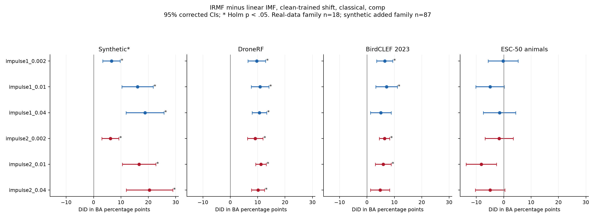
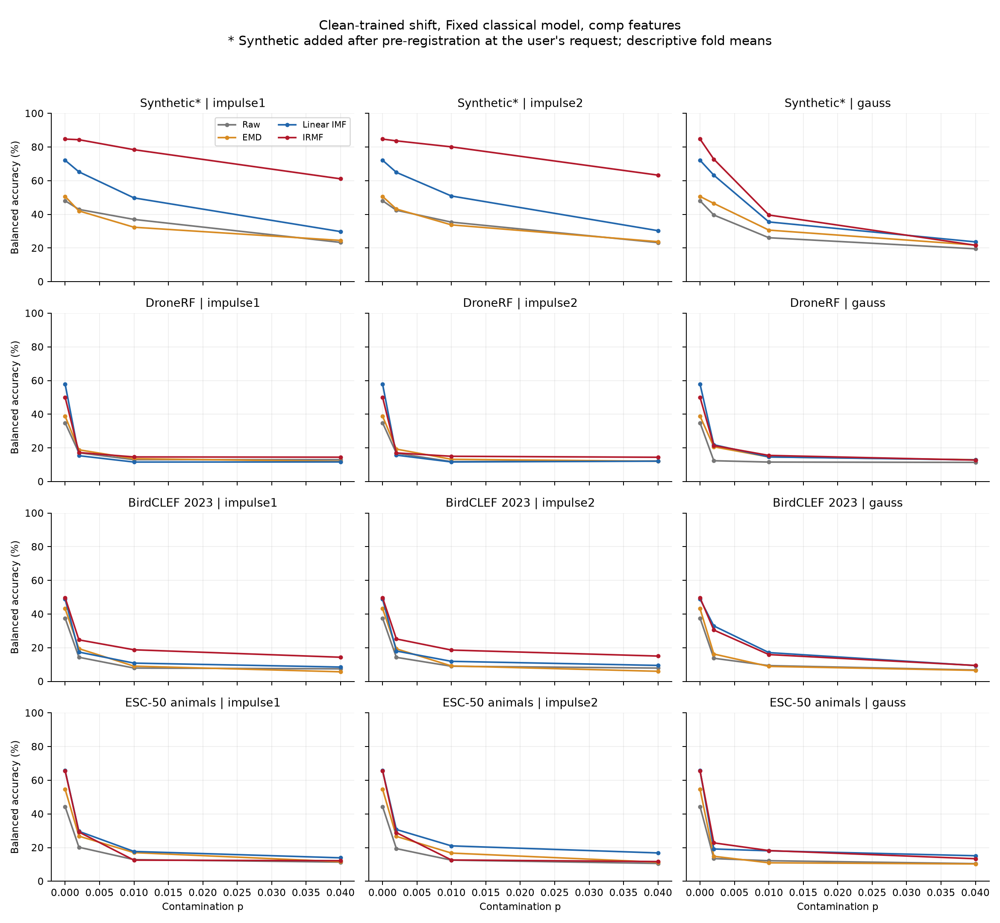
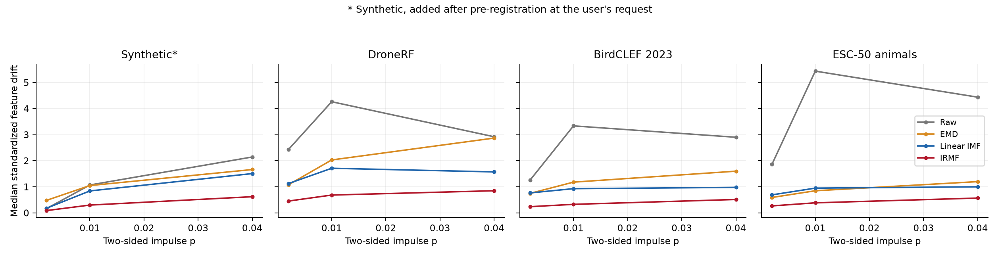

# Impulsive contamination and classification robustness

## Question and design

The experiment asks whether injected impulses improve the relative classification performance of converged IRMF against linear IMF. A positive difference-in-differences means the IRMF minus linear IMF gap becomes more favorable under contamination. It does not mean contaminated accuracy exceeds clean accuracy.

The [pre-registration](../../../experiments/classification-emd-irmf/robustness/PROTOCOL_robustness.md) was committed as `d44a287` before any contaminated classification result. The implementation and dated synthetic amendment were committed as `c2777d7`. Four inputs see the same prepared frames and common random numbers. The real tasks are DroneRF 10class, BirdCLEF 2023 species and ESC-50 animals, with synthetic signal added as specified below. The 60 GHz radar is excluded. A=10 and p is .002, .01 or .04. One-sided and two-sided exponential spikes share positions/magnitudes; Gaussian noise matches their expected squared-noise power. Injection precedes the shared median/MAD normalization.

The existing grouped five-fold, three-seed splits are preserved. The fixed 100 pilot frames per dataset are excluded from both training and testing in every condition. Analysis populations before solver exclusions are synthetic 1,400, DroneRF 11,900, BirdCLEF 11,900 and ESC-50 5,000. Synthetic was run end to end first. Clean cache verification passed for all four methods on 50 frames per dataset (800/800 exactly equal, all others within float32 rounding). [Verification audit](validation.json).

Classical models reuse the exact shared runner pipelines: linear SVM on DroneRF/ESC-50, logistic regression on BirdCLEF/synthetic, with grouped inner selection over the shared C grids. LightGBM reuses the shared 500-round cap, early stopping and grouped training-only validation. Component-only features are primary; both classifiers also use comp+log_scale. Shift fits one clean model per split/input/feature set/classifier and predicts all ten conditions. Matched classical fits the three p=.04 conditions. All scaling, imputation and selection use training rows only. [Per-split scores](per_split_scores.csv), [fit costs and selected parameters via fit keys](fit_costs.csv).

## Primary results

The confirmatory family has the 18 real-data impulse DiDs below, with two-sided Nadeau-Bengio corrected t-tests, Holm correction across those 18, and marginal 95% corrected intervals. Wilcoxon and its own Holm correction are saved as secondary tests. Corrected variances use the observed per-split test/train frame-count ratios. All values are fold-paired. [Full tests](paired_tests.csv), [paired DiD vectors](paired_vectors.csv).

Synthetic* is "synthetic, added after pre-registration at the user's request". Its six primary counterparts appear alongside the real datasets, but its Holm correction spans all 87 synthetic primary/S1-S5 tests in a separate family. It changes none of the pre-registered real-data families.

| Dataset | Condition | DiD, pp | 95% corrected CI, pp | Holm p |
|---|---|---:|---|---:|
| Synthetic* | impulse1_0.002 | [+6.520](primary_tests.csv#L2) | [+3.314, +9.726](primary_tests.csv#L2) | [0.021498](primary_tests.csv#L2) |
| Synthetic* | impulse1_0.01 | [+16.058](primary_tests.csv#L3) | [+10.373, +21.744](primary_tests.csv#L3) | [0.0016803](primary_tests.csv#L3) |
| Synthetic* | impulse1_0.04 | [+18.756](primary_tests.csv#L4) | [+11.844, +25.667](primary_tests.csv#L4) | [0.0024441](primary_tests.csv#L4) |
| Synthetic* | impulse2_0.002 | [+6.129](primary_tests.csv#L5) | [+3.027, +9.231](primary_tests.csv#L5) | [0.026467](primary_tests.csv#L5) |
| Synthetic* | impulse2_0.01 | [+16.612](primary_tests.csv#L6) | [+10.477, +22.746](primary_tests.csv#L6) | [0.0024514](primary_tests.csv#L6) |
| Synthetic* | impulse2_0.04 | [+20.410](primary_tests.csv#L7) | [+11.931, +28.889](primary_tests.csv#L7) | [0.0059758](primary_tests.csv#L7) |
| DroneRF | impulse1_0.002 | [+9.688](primary_tests.csv#L8) | [+6.472, +12.905](primary_tests.csv#L8) | [0.00017942](primary_tests.csv#L8) |
| DroneRF | impulse1_0.01 | [+10.853](primary_tests.csv#L9) | [+7.614, +14.093](primary_tests.csv#L9) | [6.5371e-05](primary_tests.csv#L9) |
| DroneRF | impulse1_0.04 | [+10.638](primary_tests.csv#L10) | [+7.998, +13.277](primary_tests.csv#L10) | [8.789e-06](primary_tests.csv#L10) |
| DroneRF | impulse2_0.002 | [+9.131](primary_tests.csv#L11) | [+6.317, +11.945](primary_tests.csv#L11) | [8.6717e-05](primary_tests.csv#L11) |
| DroneRF | impulse2_0.01 | [+11.190](primary_tests.csv#L12) | [+9.273, +13.108](primary_tests.csv#L12) | [9.8008e-08](primary_tests.csv#L12) |
| DroneRF | impulse2_0.04 | [+10.125](primary_tests.csv#L13) | [+7.757, +12.493](primary_tests.csv#L13) | [4.5943e-06](primary_tests.csv#L13) |
| BirdCLEF 2023 | impulse1_0.002 | [+6.476](primary_tests.csv#L14) | [+3.528, +9.424](primary_tests.csv#L14) | [0.0036727](primary_tests.csv#L14) |
| BirdCLEF 2023 | impulse1_0.01 | [+7.136](primary_tests.csv#L15) | [+3.208, +11.064](primary_tests.csv#L15) | [0.014509](primary_tests.csv#L15) |
| BirdCLEF 2023 | impulse1_0.04 | [+5.048](primary_tests.csv#L16) | [+1.240, +8.857](primary_tests.csv#L16) | [0.078197](primary_tests.csv#L16) |
| BirdCLEF 2023 | impulse2_0.002 | [+6.395](primary_tests.csv#L17) | [+4.498, +8.292](primary_tests.csv#L17) | [6.5234e-05](primary_tests.csv#L17) |
| BirdCLEF 2023 | impulse2_0.01 | [+5.912](primary_tests.csv#L18) | [+3.022, +8.803](primary_tests.csv#L18) | [0.0061968](primary_tests.csv#L18) |
| BirdCLEF 2023 | impulse2_0.04 | [+4.775](primary_tests.csv#L19) | [+1.269, +8.281](primary_tests.csv#L19) | [0.078197](primary_tests.csv#L19) |
| ESC-50 animals | impulse1_0.002 | [-0.240](primary_tests.csv#L20) | [-5.696, +5.216](primary_tests.csv#L20) | [1](primary_tests.csv#L20) |
| ESC-50 animals | impulse1_0.01 | [-4.984](primary_tests.csv#L21) | [-10.189, +0.221](primary_tests.csv#L21) | [0.29578](primary_tests.csv#L21) |
| ESC-50 animals | impulse1_0.04 | [-1.527](primary_tests.csv#L22) | [-7.435, +4.382](primary_tests.csv#L22) | [1](primary_tests.csv#L22) |
| ESC-50 animals | impulse2_0.002 | [-1.683](primary_tests.csv#L23) | [-6.829, +3.463](primary_tests.csv#L23) | [1](primary_tests.csv#L23) |
| ESC-50 animals | impulse2_0.01 | [-8.192](primary_tests.csv#L24) | [-13.750, -2.633](primary_tests.csv#L24) | [0.055532](primary_tests.csv#L24) |
| ESC-50 animals | impulse2_0.04 | [-4.947](primary_tests.csv#L25) | [-10.319, +0.425](primary_tests.csv#L25) | [0.29578](primary_tests.csv#L25) |



The pre-specified reading requires a positive Holm-significant impulse DiD at p=.04 and a smaller matched-power Gaussian DiD. The following rows apply that rule literally. Synthetic has amended status, so its result is not confirmatory. [Reading CSV](prespecified_reading.csv).

- Synthetic*: rule met for impulse1_0.04, impulse2_0.04. impulse1_0.04: +18.756 pp, Holm p=0.0024441; impulse2_0.04: +20.410 pp, Holm p=0.0059758. Gaussian DiD at .04 is -14.585 pp.
- DroneRF: rule met for impulse1_0.04, impulse2_0.04. impulse1_0.04: +10.638 pp, Holm p=8.789e-06; impulse2_0.04: +10.125 pp, Holm p=4.5943e-06. Gaussian DiD at .04 is +7.702 pp.
- BirdCLEF 2023: rule not met. impulse1_0.04: +5.048 pp, Holm p=0.078197; impulse2_0.04: +4.775 pp, Holm p=0.078197. Gaussian DiD at .04 is -0.721 pp.
- ESC-50 animals: rule not met. impulse1_0.04: -1.527 pp, Holm p=1; impulse2_0.04: -4.947 pp, Holm p=0.29578. Gaussian DiD at .04 is -1.591 pp.

## Secondary results, exploratory

Each real-data secondary family has its own Holm correction: S1=18, S2=27, S3=54, S4=108 and S5=36. Synthetic remains in its separate 87-test family. S1 compares IRMF with EMD; S2 tests Gaussian DiDs and impulse-minus-Gaussian DiDs; S3 uses LightGBM; S4 adds log_scale; S5 trains and tests with matched contamination relative to the clean-trained/clean-tested baseline. [All tests](paired_tests.csv).

| Dataset | Family | Tests | Positive Holm p < .05 | Negative Holm p < .05 | Mean DiD range, pp |
|---|---|---:|---:|---:|---|
| Synthetic* | S1 | 6 | 4 | 0 | +2.49 to +12.26 |
| Synthetic* | S2 | 9 | 6 | 1 | -14.58 to +34.99 |
| Synthetic* | S3 | 18 | 8 | 4 | -43.73 to +29.95 |
| Synthetic* | S4 | 36 | 15 | 9 | -48.89 to +31.92 |
| Synthetic* | S5 | 12 | 8 | 4 | -29.16 to +29.23 |
| DroneRF | S1 | 6 | 0 | 6 | -13.52 to -8.72 |
| DroneRF | S2 | 9 | 3 | 0 | +1.82 to +8.74 |
| DroneRF | S3 | 18 | 7 | 3 | -10.93 to +10.20 |
| DroneRF | S4 | 36 | 16 | 12 | -13.01 to +8.97 |
| DroneRF | S5 | 12 | 6 | 2 | -10.48 to +9.87 |
| BirdCLEF 2023 | S1 | 6 | 0 | 0 | -1.27 to +3.23 |
| BirdCLEF 2023 | S2 | 9 | 4 | 0 | -3.22 to +9.70 |
| BirdCLEF 2023 | S3 | 18 | 13 | 0 | -0.61 to +21.65 |
| BirdCLEF 2023 | S4 | 36 | 18 | 0 | -4.30 to +21.83 |
| BirdCLEF 2023 | S5 | 12 | 5 | 0 | -0.61 to +10.72 |
| ESC-50 animals | S1 | 6 | 0 | 6 | -15.43 to -8.52 |
| ESC-50 animals | S2 | 9 | 0 | 0 | -8.50 to +3.82 |
| ESC-50 animals | S3 | 18 | 12 | 0 | -3.50 to +28.42 |
| ESC-50 animals | S4 | 36 | 12 | 4 | -15.46 to +30.20 |
| ESC-50 animals | S5 | 12 | 4 | 0 | -5.55 to +15.84 |

Selected p=.04 contrasts below make the secondary families easier to inspect. They were selected by the pre-specified severity, not by statistical significance. [Source tests](paired_tests.csv).

| Dataset | Contrast | DiD, pp | 95% corrected CI, pp | Holm p |
|---|---|---:|---|---:|
| Synthetic* | S1, logreg, EMD, DiD | +5.441 | [-3.092, +13.973] | 1 |
| Synthetic* | S2, logreg, Linear IMF, impulse_minus_gauss_DiD | +34.995 | [+28.459, +41.531] | 1.2972e-06 |
| Synthetic* | S3, lightgbm, Linear IMF, DiD | +29.955 | [+21.764, +38.145] | 0.00012047 |
| Synthetic* | S4, logreg, Linear IMF, DiD | +20.665 | [+11.903, +29.427] | 0.0068052 |
| Synthetic* | S5, logreg, Linear IMF, DiD | +27.865 | [+22.093, +33.638] | 4.7315e-06 |
| DroneRF | S1, linsvm, EMD, DiD | -8.884 | [-10.526, -7.242] | 2.4403e-07 |
| DroneRF | S2, linsvm, Linear IMF, impulse_minus_gauss_DiD | +2.423 | [+0.598, +4.249] | 0.18091 |
| DroneRF | S3, lightgbm, Linear IMF, DiD | +9.443 | [+7.772, +11.113] | 4.1014e-07 |
| DroneRF | S4, linsvm, Linear IMF, DiD | +8.281 | [+5.898, +10.664] | 0.00022282 |
| DroneRF | S5, linsvm, Linear IMF, DiD | +9.871 | [+8.133, +11.610] | 2.3179e-07 |
| BirdCLEF 2023 | S1, logreg, EMD, DiD | +2.558 | [-0.636, +5.752] | 0.43144 |
| BirdCLEF 2023 | S2, logreg, Linear IMF, impulse_minus_gauss_DiD | +5.496 | [+1.951, +9.040] | 0.090028 |
| BirdCLEF 2023 | S3, lightgbm, Linear IMF, DiD | +14.986 | [+11.593, +18.379] | 6.734e-06 |
| BirdCLEF 2023 | S4, logreg, Linear IMF, DiD | +5.772 | [+2.343, +9.202] | 0.12225 |
| BirdCLEF 2023 | S5, logreg, Linear IMF, DiD | +2.228 | [+0.775, +3.681] | 0.10229 |
| ESC-50 animals | S1, linsvm, EMD, DiD | -10.590 | [-15.631, -5.549] | 0.0049402 |
| ESC-50 animals | S2, linsvm, Linear IMF, impulse_minus_gauss_DiD | -3.356 | [-8.090, +1.377] | 1 |
| ESC-50 animals | S3, lightgbm, Linear IMF, DiD | +27.919 | [+17.884, +37.953] | 0.00079179 |
| ESC-50 animals | S4, linsvm, Linear IMF, DiD | -5.608 | [-10.637, -0.580] | 1 |
| ESC-50 animals | S5, linsvm, Linear IMF, DiD | +7.247 | [+1.669, +12.825] | 0.18927 |

## Absolute classification performance

The curves show mean fold balanced accuracy for every input under clean training, the fixed classical family and comp features. They are descriptive. Clean models are reused across conditions. Every condition/classifier/scale variant is available in [per_split_scores.csv](per_split_scores.csv) and [score_summary.csv](score_summary.csv).



Additional full degradation curves: [classical with log_scale](figures/ba_curves_classical_with_scale.png), [LightGBM comp](figures/ba_curves_lightgbm_comp.png), [LightGBM with log_scale](figures/ba_curves_lightgbm_with_scale.png).

| Dataset | Input | Clean BA, % | One-sided .04 BA, % | Two-sided .04 BA, % | Gaussian .04 BA, % |
|---|---|---:|---:|---:|---:|
| Synthetic* | Raw | 48.090 | 23.340 | 23.230 | 19.554 |
| Synthetic* | EMD | 50.643 | 24.545 | 23.782 | 21.794 |
| Synthetic* | Linear IMF | 72.145 | 29.781 | 30.315 | 23.653 |
| Synthetic* | IRMF | 84.731 | 61.123 | 63.310 | 21.654 |
| DroneRF | Raw | 34.879 | 12.994 | 12.198 | 11.388 |
| DroneRF | EMD | 38.819 | 11.962 | 12.069 | 12.974 |
| DroneRF | Linear IMF | 57.872 | 11.654 | 12.112 | 12.864 |
| DroneRF | IRMF | 50.061 | 14.481 | 14.426 | 12.755 |
| BirdCLEF 2023 | Raw | 37.590 | 7.471 | 7.926 | 6.776 |
| BirdCLEF 2023 | EMD | 43.218 | 5.706 | 6.009 | 6.551 |
| BirdCLEF 2023 | Linear IMF | 48.921 | 8.525 | 9.496 | 9.421 |
| BirdCLEF 2023 | IRMF | 49.704 | 14.357 | 15.054 | 9.484 |
| ESC-50 animals | Raw | 44.339 | 11.367 | 10.583 | 10.467 |
| ESC-50 animals | EMD | 54.622 | 11.629 | 11.329 | 10.282 |
| ESC-50 animals | Linear IMF | 65.758 | 13.918 | 16.822 | 15.147 |
| ESC-50 animals | IRMF | 65.578 | 12.212 | 11.695 | 13.376 |

## Representation stability

Feature drift is the mean absolute change divided by each feature's clean all-frame population SD, with SD=1 for constants. This descriptive standardization never enters the classifier. The relative L2 measures compare each contaminated stack with its own clean float32 cached stack, within channels, with denominator floor 1e-12. Raw features use the shared float64 normalized samples. EMD slots can mode-mix; similarly numbered EMD/IMF slots are not matched frequency bands. [All conditions and slots](stability_metrics.csv).

| Dataset | Input | Feature drift median / p95, comp | Whole-stack relative L2 median / p95 |
|---|---|---|---|
| Synthetic* | Raw | 2.145 / 3.241 | 2.195 / 3.354 |
| Synthetic* | EMD | 1.663 / 2.603 | 2.967 / 5.031 |
| Synthetic* | Linear IMF | 1.508 / 2.243 | 1.884 / 2.842 |
| Synthetic* | IRMF | 0.6215 / 0.886 | 2.916 / 4.814 |
| DroneRF | Raw | 2.92 / 4.901 | 3.021 / 4.061 |
| DroneRF | EMD | 2.87 / 4.041 | 4.07 / 5.616 |
| DroneRF | Linear IMF | 1.572 / 2.186 | 3.024 / 4.022 |
| DroneRF | IRMF | 0.8505 / 1.158 | 4.342 / 6.321 |
| BirdCLEF 2023 | Raw | 2.901 / 4.878 | 2.533 / 3.653 |
| BirdCLEF 2023 | EMD | 1.6 / 2.632 | 5.042 / 9.12 |
| BirdCLEF 2023 | Linear IMF | 0.9788 / 1.683 | 2.621 / 3.863 |
| BirdCLEF 2023 | IRMF | 0.5147 / 1.147 | 4.453 / 7.037 |
| ESC-50 animals | Raw | 4.438 / 7.406 | 2.574 / 3.589 |
| ESC-50 animals | EMD | 1.2 / 1.913 | 5.975 / 10.33 |
| ESC-50 animals | Linear IMF | 1.001 / 1.522 | 2.681 / 3.778 |
| ESC-50 animals | IRMF | 0.5687 / 0.8958 | 4.945 / 7.351 |



The [fixed-subset component examples](figures/component_examples.png) use the first pre-selected pilot ID per dataset, channel zero, for two-sided impulses at .04. These IDs were not selected by classification or drift results. Full stacks are retained only for the 100 fixed pilot/figure IDs per dataset/condition.

## H diagnostics, convergence and exclusions

H is recomputed per channel from the contaminated normalized frame. The ratios below are channel-level medians, not ratios of dataset-level medians. [All H ratios, retries and failures](solver_diagnostics.csv), [failed frames](failed_frames.csv).

| Dataset | Condition | Median H / clean H | p95 | Cap-100 channel retries | Final failed frames |
|---|---|---:|---:|---:|---:|
| Synthetic* | impulse1_0.04 | 1.046 | 1.0913 | 0 | 0 |
| Synthetic* | impulse2_0.04 | 1.0479 | 1.0918 | 0 | 0 |
| Synthetic* | gauss_0.04 | 1.6736 | 2.3992 | 0 | 0 |
| DroneRF | impulse1_0.04 | 1.0584 | 1.5 | 0 | 0 |
| DroneRF | impulse2_0.04 | 1.0577 | 1.5 | 0 | 0 |
| DroneRF | gauss_0.04 | 0.99269 | 1.4672 | 0 | 0 |
| BirdCLEF 2023 | impulse1_0.04 | 1.0496 | 1.1065 | 0 | 0 |
| BirdCLEF 2023 | impulse2_0.04 | 1.0507 | 1.1059 | 0 | 0 |
| BirdCLEF 2023 | gauss_0.04 | 1.9707 | 9.5667 | 0 | 0 |
| ESC-50 animals | impulse1_0.04 | 1.054 | 1.114 | 0 | 0 |
| ESC-50 animals | impulse2_0.04 | 1.0551 | 1.1103 | 0 | 0 |
| ESC-50 animals | gauss_0.04 | 3.7042 | 10.825 | 0 | 0 |

Across all full contaminated runs there were 0 cap-100 channel retries involving 0 frame-condition pairs, and 0 final IRMF failed frame-condition pairs. Every accepted IRMF channel converged. The timing pilots had zero cap hits and zero failed channels. [Pilot measurements](../../../experiments/classification-emd-irmf/robustness/provenance/pilot_costs.csv).

## Compute cost and dependency audit

The real datasets overlapped after the dated scheduling change. DroneRF used six workers, BirdCLEF four and ESC-50 two, for at most 12 robustness workers total; each used one BLAS/OpenMP thread. Stage wall times below overlap, so their sum is total stage exposure rather than elapsed real-batch makespan. The table separates stage wall time from measured CPU summed over worker fits. Feature CPU includes decomposition, feature extraction and stack/drift comparison inside each method timer. It excludes worker initialization, I/O and the shared H-ratio calculation outside those timers. Classifier CPU includes fitting and prediction/scoring in the worker. No historical clean decomposition CPU is charged again. [Feature costs](costs.csv), [individual fit costs](fit_costs.csv), [stage wall times](wall_times.csv).

| Dataset | Feature wall, s | Classification wall, s | Feature measured CPU, s | Classifier measured CPU, s |
|---|---:|---:|---:|---:|
| Synthetic* | 97.27 | 66.99 | 539.99 | 387.13 |
| DroneRF | 4228.63 | 76548.22 | 24850.14 | 433403.51 |
| BirdCLEF 2023 | 5618.22 | 2708.73 | 20388.54 | 8361.40 |
| ESC-50 animals | 5351.45 | 19588.81 | 9742.30 | 37110.04 |

Stage wall times sum to 114208.32 s; measured compute CPU sums to 534783.05 s. Restart records add 3204.93 worker CPU s from interrupted work, initialization and checkpoint publication outside completed-fit timers. The measured total including that restart overhead is 537987.98 CPU s. The timing pilots add 25.83 wall s and 120.25 measured CPU s. Stage totals exclude test-suite runs and report rendering. External robustness data occupy 6.404 GB at analysis, below the 60 GB limit. The pinned pimf version is 0.4.0. Every top-level installed pimf Python file's SHA-256 matched the starting record immediately before final analysis. [Dependency audit](environment_audit.json). No shared module was edited.

## Deviations and scope

- On 2026-10-21, after pre-registration, the user added synthetic primary/S1-S5 tests and requested synthetic in every table/figure. They form a separate 87-test Holm family and are labelled post-registration throughout.
- The pre-registered timing rule applied all three permitted cuts in order. Matched LightGBM was first reduced to seed 0, then dropped, and matched classical was restricted to p=.04. All shift conditions and all 18 primary tests were retained. The initial conservative projection was 42.51 h and 18.27 h after cuts, using historical wall-time proxies and a DroneRF grid workload multiplier. Actual stage times are reported above; cuts were not reversed after seeing results.
- The first clean-verification implementation rounded the raw control to float32 before feature extraction. This caused five of 50 synthetic checks to exceed one float32 rounding unit. It was corrected to the unchanged shared float64 raw path before any contaminated feature or classification result. The failed audit and its manifest remain preserved externally. Active provenance uses manifest_v2.json and clean_verification_v2.json. Numeric feature chunks contain all four methods in one file per frame block, rather than separate files per method. 800/800 active clean checks were exact; all passed the pre-specified float32-rounding criterion, so cached clean features were reused without recomputation.
- An initial multiprocessing launch from stdin failed before computation. All successful runs use importable modules. No checkpoint or result was replaced.
- A provider interruption left the DroneRF batch attached to an old pipe. After 66 fit checkpoints, a detached watcher stopped its process group and restarted the batch with file-backed output. The completed checkpoints retained their SHA-256 hashes. The interruption added 3226.42 wall s and 3204.93 uncheckpointed worker CPU s; both are included in the cost section. The file-backed [batch log](/Users/mikhail/Datasets/imf-classification/dronerf/robustness/runs/detached/20261021T072744_137930Z.log) is under the dataset robustness directory. [Restart audit](/Users/mikhail/Datasets/imf-classification/dronerf/robustness/runs/restarts/20261021T072742_706258Z.json).
- On 2026-10-21T15:02:20.561292+00:00, at the user's request, BirdCLEF and ESC-50 were started concurrently with DroneRF to bring their results forward. The serial launcher (PID 19215) was stopped while its DroneRF child (PID 19217) continued. The old report waiter was replaced with one that checks each dataset completion. Dataset-specific locks prevent concurrent runs on the same dataset. The allocation was DroneRF six, BirdCLEF four and ESC-50 two single-thread workers. Within each dataset, all feature conditions precede shift classical fits, which precede LightGBM and matched fits. Only scheduling changed; conditions, features, classifiers and splits did not. [Run record](/Users/mikhail/Datasets/imf-classification/dronerf/robustness/runs/parallel_schedule.json).
- The shared current classical grids are used as requested. In particular, DroneRF uses the full shared SVM C grid, whereas the historical 10class report used fixed C=.1. The new clean scores are therefore the baselines for every new DiD, rather than historical scores.
- The 100 pilot IDs per dataset are removed from both fitting and testing to implement the explicit pilot-frame exclusion. Their descriptive representation metrics and example stacks are retained, but they contribute to no classification test. Existing group partitions and split IDs remain unchanged.

The experiment is conditional on the prepared populations and injected noise model. It does not identify naturally occurring impulses, establish unseen-session DroneRF performance, or show robustness to other corruption mechanisms. Positive DiDs can coexist with lower absolute IRMF BA. Absolute degradation curves and Gaussian controls are needed to read the relative effects.

## Reproduction

From the checkout root, enter the study directory and use the pinned environment. Completed immutable checkpoints resume; existing output artifacts are never overwritten.

```bash
cd experiments/classification-emd-irmf
export IMF_CLS_DATA=/Users/mikhail/Datasets/imf-classification
export OMP_NUM_THREADS=1 OPENBLAS_NUM_THREADS=1 MKL_NUM_THREADS=1
export VECLIB_MAXIMUM_THREADS=1 NUMEXPR_NUM_THREADS=1 NUMBA_NUM_THREADS=1
PY=../../.venv/bin/python
$PY -m pytest -q tests robustness/tests
$PY -m robustness.run --dataset synthetic --workers 6
$PY -c 'from robustness.analysis import smoke; smoke()'
$PY -m robustness.run_locked --dataset dronerf --workers 6
$PY -m robustness.run_locked --dataset birdclef2023 --workers 4
$PY -m robustness.run_locked --dataset esc50_animals --workers 2
$PY -m robustness.analyse
```

The timing pilot commands and protocol details are in [robustness/README.md](../../../experiments/classification-emd-irmf/robustness/README.md). All full data, numeric checkpoints and predictions remain under each dataset's external robustness directory. CSVs retain fractions; report tables and forests multiply score differences by 100 to show percentage points.
