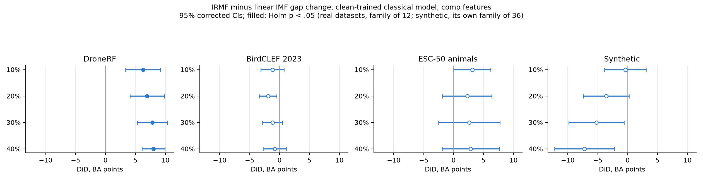
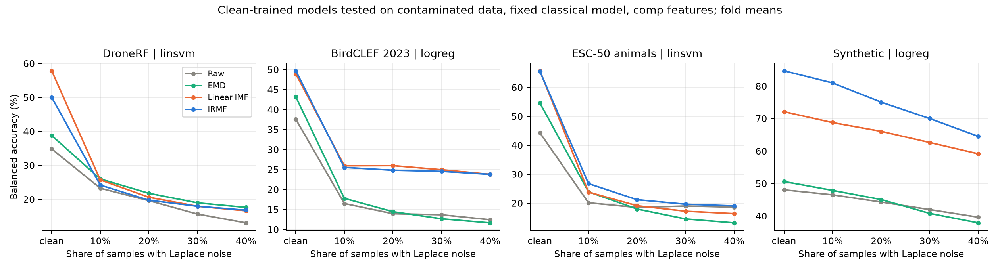
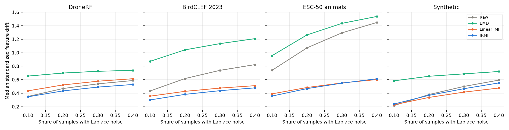

# Laplace contamination and classification robustness

## Question and design

Does IRMF keep more of its classification performance than linear IMF when a growing share of samples carries Laplace noise? A positive difference-in-differences (DiD) means the IRMF minus linear IMF gap becomes more favorable under contamination. It does not mean contaminated accuracy exceeds clean accuracy.

The [protocol](../../../experiments/classification-emd-irmf/robustness_laplace/PROTOCOL_laplace.md) was written before any contaminated result, and its SHA-256 is in every run manifest. It reuses the [impulse experiment](../robustness/REPORT.md) and changes the noise. With probability p a sample receives Laplace(0, b) noise, b = 1 robust SD of the clean channel (1.4826 MAD), for p = 0.1, 0.2, 0.3 and 0.4. There is no Gaussian term and no Gaussian control. The draws are the impulse run's, so the masks are nested across p and its two-sided spikes at 4% sit on the same samples, at ten times the scale. Injection precedes the shared median/MAD normalization.

Datasets, inputs, splits, the 100 excluded pilot frames per dataset, features and classifiers are unchanged. The real tasks are DroneRF 10class, BirdCLEF 2023 species and ESC-50 animals; synthetic is its own Holm family. The 60 GHz radar is excluded. IRMF uses the converged Numba Newton solver. Clean features reproduced the cache on 50 frames per dataset (800/800 exactly). [Validation](validation.json).

Shift fits train one clean model per split, input, feature set and classifier and predict every condition. To save time, the clean classical models were refit at the C the impulse run had selected on the same training rows, and accepted only if their clean predictions matched that run's on every test frame. 480 of 480 matched; the rest reran the full grid search. A match confirms the inputs and C. The solvers are deterministic (primal liblinear for the SVM, lbfgs for logistic regression), which is what makes the refit the same model. LightGBM shift fits reran in full, and 480 of 480 reproduced the impulse run's clean predictions exactly. Matched fits train and test at p = 0.4 with the full grid. [Per-split scores](per_split_scores.csv), [fit costs](fit_costs.csv).

## Primary results

The primary family holds the 12 real-data DiDs below: IRMF minus linear IMF, clean-trained fixed classical model, comp features. Tests are two-sided Nadeau-Bengio corrected t-tests with Holm correction across the family and marginal 95% corrected intervals. Wilcoxon tests are saved as secondary. Values are fold-paired percentage points. [Full tests](paired_tests.csv), [paired vectors](paired_vectors.csv).

| Dataset | Laplace share | DiD, pp | 95% CI, pp | Holm p |
|---|---|---:|---|---:|
| DroneRF | 10% | +6.27 | [+3.36, +9.18] | 0.0036 |
| DroneRF | 20% | +6.94 | [+4.07, +9.81] | 0.0014 |
| DroneRF | 30% | +7.82 | [+5.32, +10.32] | 1.1e-04 |
| DroneRF | 40% | +8.00 | [+6.10, +9.90] | 3.9e-06 |
| BirdCLEF 2023 | 10% | -1.19 | [-3.11, +0.73] | 1 |
| BirdCLEF 2023 | 20% | -1.93 | [-3.40, -0.47] | 0.11 |
| BirdCLEF 2023 | 30% | -1.19 | [-2.86, +0.48] | 0.89 |
| BirdCLEF 2023 | 40% | -0.79 | [-2.67, +1.09] | 1 |
| ESC-50 animals | 10% | +3.10 | [-0.01, +6.22] | 0.35 |
| ESC-50 animals | 20% | +2.26 | [-1.87, +6.40] | 1 |
| ESC-50 animals | 30% | +2.59 | [-2.53, +7.72] | 1 |
| ESC-50 animals | 40% | +2.85 | [-1.92, +7.63] | 1 |
| Synthetic | 10% | -0.37 | [-3.85, +3.10] | 1 |
| Synthetic | 20% | -3.60 | [-7.43, +0.23] | 1 |
| Synthetic | 30% | -5.21 | [-9.81, -0.61] | 0.7 |
| Synthetic | 40% | -7.22 | [-12.20, -2.25] | 0.24 |

Synthetic p values are Holm-corrected within its own family of 36 tests.



The protocol reads IRMF as more robust on a dataset if the 40% DiD is positive with Holm p < .05, and linear IMF as more robust if it is negative with Holm p < .05. [Reading CSV](prespecified_reading.csv).

- DroneRF: IRMF more robust. DiD at 40% +8.00 pp, [+6.10, +9.90], Holm p 3.9e-06.
- BirdCLEF 2023: no significant difference. DiD at 40% -0.79 pp, [-2.67, +1.09], Holm p 1.
- ESC-50 animals: no significant difference. DiD at 40% +2.85 pp, [-1.92, +7.63], Holm p 1.
- Synthetic: no significant difference. DiD at 40% -7.22 pp, [-12.20, -2.25], Holm p 0.24.

## Secondary results, exploratory

Each real-data family has its own Holm correction: S1 = 12, S3 = 24, S4 = 48 and S5 = 12. S1 compares IRMF with EMD; S3 uses LightGBM; S4 adds log_scale; S5 trains and tests at 40% relative to the clean-trained, clean-tested baseline. The impulse run's S2 tested Gaussian controls and has no counterpart.

| Dataset | Family | Tests | Positive, Holm p < .05 | Negative, Holm p < .05 | DiD range, pp |
|---|---|---:|---:|---:|---|
| DroneRF | S1 | 4 | 0 | 4 | -13.28 to -12.06 |
| DroneRF | S3 | 8 | 1 | 4 | -8.90 to +4.70 |
| DroneRF | S4 | 16 | 4 | 6 | -12.14 to +5.32 |
| DroneRF | S5 | 4 | 2 | 2 | -6.76 to +5.47 |
| BirdCLEF 2023 | S1 | 4 | 3 | 0 | +1.26 to +5.66 |
| BirdCLEF 2023 | S3 | 8 | 4 | 0 | +0.49 to +11.35 |
| BirdCLEF 2023 | S4 | 16 | 4 | 0 | -1.94 to +11.64 |
| BirdCLEF 2023 | S5 | 4 | 0 | 0 | -0.43 to +0.68 |
| ESC-50 animals | S1 | 4 | 0 | 1 | -8.14 to -5.07 |
| ESC-50 animals | S3 | 8 | 5 | 0 | +1.72 to +8.96 |
| ESC-50 animals | S4 | 16 | 1 | 1 | -9.28 to +6.99 |
| ESC-50 animals | S5 | 4 | 0 | 0 | -4.04 to +1.59 |
| Synthetic | S1 | 4 | 0 | 0 | -7.45 to -1.00 |
| Synthetic | S3 | 8 | 0 | 0 | -19.72 to -2.17 |
| Synthetic | S4 | 16 | 0 | 1 | -18.04 to -0.23 |
| Synthetic | S5 | 4 | 0 | 0 | -5.87 to -3.66 |

Selected 40% contrasts, chosen by severity, not by significance:

| Dataset | Contrast | DiD, pp | 95% CI, pp | Holm p |
|---|---|---:|---|---:|
| DroneRF | S1, classical vs EMD | -12.06 | [-13.87, -10.25] | 1.2e-08 |
| DroneRF | S3, LightGBM vs linear IMF | +1.95 | [-0.20, +4.09] | 0.5 |
| DroneRF | S3, LightGBM vs EMD | -8.90 | [-10.33, -7.47] | 5.4e-08 |
| DroneRF | S4, classical + log_scale vs linear IMF | +5.32 | [+3.52, +7.12] | 7.4e-04 |
| DroneRF | S5, matched training vs linear IMF | +5.47 | [+3.93, +7.02] | 3.0e-05 |
| DroneRF | S5, matched training vs EMD | -5.64 | [-8.04, -3.24] | 0.0018 |
| BirdCLEF 2023 | S1, classical vs EMD | +5.66 | [+3.17, +8.15] | 0.002 |
| BirdCLEF 2023 | S3, LightGBM vs linear IMF | +0.49 | [-1.92, +2.90] | 0.94 |
| BirdCLEF 2023 | S3, LightGBM vs EMD | +10.20 | [+7.09, +13.31] | 1.2e-04 |
| BirdCLEF 2023 | S4, classical + log_scale vs linear IMF | -1.68 | [-3.45, +0.10] | 1 |
| BirdCLEF 2023 | S5, matched training vs linear IMF | -0.20 | [-1.44, +1.03] | 1 |
| BirdCLEF 2023 | S5, matched training vs EMD | +0.37 | [-1.18, +1.92] | 1 |
| ESC-50 animals | S1, classical vs EMD | -5.07 | [-10.76, +0.61] | 0.15 |
| ESC-50 animals | S3, LightGBM vs linear IMF | +1.72 | [-2.10, +5.55] | 0.94 |
| ESC-50 animals | S3, LightGBM vs EMD | +8.96 | [+4.05, +13.87] | 0.019 |
| ESC-50 animals | S4, classical + log_scale vs linear IMF | +2.58 | [-1.90, +7.06] | 1 |
| ESC-50 animals | S5, matched training vs linear IMF | +0.87 | [-2.93, +4.67] | 1 |
| ESC-50 animals | S5, matched training vs EMD | -4.04 | [-9.62, +1.53] | 1 |
| Synthetic | S1, classical vs EMD | -7.45 | [-13.66, -1.25] | 0.57 |
| Synthetic | S3, LightGBM vs linear IMF | -10.52 | [-18.20, -2.83] | 0.33 |
| Synthetic | S3, LightGBM vs EMD | -19.72 | [-31.01, -8.43] | 0.074 |
| Synthetic | S4, classical + log_scale vs linear IMF | -5.87 | [-11.18, -0.55] | 0.75 |
| Synthetic | S5, matched training vs linear IMF | -3.97 | [-9.33, +1.40] | 1 |
| Synthetic | S5, matched training vs EMD | -5.17 | [-12.53, +2.18] | 1 |

## Absolute classification performance

Mean fold balanced accuracy, clean-trained fixed classical model, comp features. Descriptive. Every classifier and feature set is in [score_summary.csv](score_summary.csv).



More curves: [classical with log_scale](figures/ba_curves_classical_with_scale.png), [LightGBM comp](figures/ba_curves_lightgbm_comp.png), [LightGBM with log_scale](figures/ba_curves_lightgbm_with_scale.png).

| Dataset | Input | clean BA, % | 10% BA, % | 20% BA, % | 30% BA, % | 40% BA, % |
|---|---|---:|---:|---:|---:|---:|
| DroneRF | Raw | 34.88 | 23.31 | 19.66 | 15.72 | 13.11 |
| DroneRF | EMD | 38.82 | 26.04 | 21.83 | 19.02 | 17.67 |
| DroneRF | Linear IMF | 57.87 | 25.76 | 20.66 | 18.00 | 16.67 |
| DroneRF | IRMF | 50.06 | 24.23 | 19.79 | 18.01 | 16.85 |
| BirdCLEF 2023 | Raw | 37.59 | 16.50 | 13.96 | 13.70 | 12.44 |
| BirdCLEF 2023 | EMD | 43.22 | 17.79 | 14.46 | 12.68 | 11.66 |
| BirdCLEF 2023 | Linear IMF | 48.92 | 25.94 | 25.98 | 24.96 | 23.81 |
| BirdCLEF 2023 | IRMF | 49.70 | 25.54 | 24.83 | 24.56 | 23.80 |
| ESC-50 animals | Raw | 44.34 | 20.18 | 18.55 | 19.05 | 18.66 |
| ESC-50 animals | EMD | 54.62 | 23.97 | 18.02 | 14.59 | 13.22 |
| ESC-50 animals | Linear IMF | 65.76 | 23.86 | 19.15 | 17.26 | 16.43 |
| ESC-50 animals | IRMF | 65.58 | 26.79 | 21.24 | 19.68 | 19.11 |
| Synthetic | Raw | 48.09 | 46.55 | 44.33 | 42.01 | 39.67 |
| Synthetic | EMD | 50.64 | 47.91 | 45.10 | 40.84 | 37.91 |
| Synthetic | Linear IMF | 72.15 | 68.79 | 66.09 | 62.66 | 59.18 |
| Synthetic | IRMF | 84.73 | 81.00 | 75.08 | 70.03 | 64.54 |

## Representation stability

Feature drift is the mean absolute feature change divided by each feature's clean all-frame SD. Relative L2 compares each contaminated stack with its clean cached stack within channels. Both are descriptive and never enter a classifier. EMD slots can mode-mix, so equally numbered EMD and IMF slots are not matched bands. [All conditions and slots](stability_metrics.csv).

| Dataset | Input | Feature drift median / p95 at 40% | Whole-stack relative L2 median / p95 at 40% |
|---|---|---|---|
| DroneRF | Raw | 0.588 / 0.84 | 0.947 / 1.16 |
| DroneRF | EMD | 0.739 / 1.15 | 1.13 / 1.41 |
| DroneRF | Linear IMF | 0.615 / 0.859 | 0.958 / 1.15 |
| DroneRF | IRMF | 0.529 / 0.807 | 0.947 / 1.14 |
| BirdCLEF 2023 | Raw | 0.824 / 1.44 | 0.746 / 1.03 |
| BirdCLEF 2023 | EMD | 1.21 / 1.96 | 1.32 / 1.77 |
| BirdCLEF 2023 | Linear IMF | 0.512 / 1.14 | 0.767 / 1.09 |
| BirdCLEF 2023 | IRMF | 0.479 / 1.08 | 0.777 / 1.12 |
| ESC-50 animals | Raw | 1.45 / 2.09 | 0.763 / 1 |
| ESC-50 animals | EMD | 1.54 / 2.25 | 1.49 / 1.81 |
| ESC-50 animals | Linear IMF | 0.602 / 1.05 | 0.791 / 1.05 |
| ESC-50 animals | IRMF | 0.614 / 0.994 | 0.813 / 1.12 |
| Synthetic | Raw | 0.594 / 1.2 | 0.672 / 0.861 |
| Synthetic | EMD | 0.722 / 1.14 | 1.01 / 1.33 |
| Synthetic | Linear IMF | 0.477 / 0.755 | 0.573 / 0.745 |
| Synthetic | IRMF | 0.552 / 0.742 | 0.571 / 0.733 |



The [component examples](figures/component_examples.png) use the first pre-selected pilot frame per dataset, channel 0, at 40%.

## H, convergence and exclusions

IRMF recomputes H from each contaminated channel. Ratios are channel-level medians. [Diagnostics](solver_diagnostics.csv), [failed frames](failed_frames.csv).

| Dataset | Laplace share | Median H / clean H | p95 | Cap-100 retries | Failed frames |
|---|---|---:|---:|---:|---:|
| DroneRF | 10% | 1.03 | 1.5 | 0 | 0 |
| DroneRF | 20% | 1.07 | 1.5 | 0 | 0 |
| DroneRF | 30% | 1.07 | 1.5 | 0 | 0 |
| DroneRF | 40% | 1.08 | 1.5 | 0 | 0 |
| BirdCLEF 2023 | 10% | 1.08 | 1.22 | 0 | 0 |
| BirdCLEF 2023 | 20% | 1.16 | 1.53 | 0 | 0 |
| BirdCLEF 2023 | 30% | 1.25 | 2.06 | 0 | 0 |
| BirdCLEF 2023 | 40% | 1.34 | 3.08 | 0 | 0 |
| ESC-50 animals | 10% | 1.13 | 1.26 | 0 | 0 |
| ESC-50 animals | 20% | 1.3 | 1.63 | 0 | 0 |
| ESC-50 animals | 30% | 1.51 | 2.25 | 0 | 0 |
| ESC-50 animals | 40% | 1.76 | 3.49 | 0 | 0 |
| Synthetic | 10% | 1.06 | 1.12 | 0 | 0 |
| Synthetic | 20% | 1.12 | 1.22 | 0 | 0 |
| Synthetic | 30% | 1.19 | 1.35 | 0 | 0 |
| Synthetic | 40% | 1.26 | 1.48 | 0 | 0 |

## Compute cost

Each run used one pool of 14 single-thread workers for its datasets. Wall times: Synthetic in 36 s; DroneRF and BirdCLEF 2023 and ESC-50 animals in 4.03 h. Measured CPU: 4.71 h for decomposition, features and stability, 50.62 h for fitting and prediction. External data occupy 3.02 GB. pimf is 0.4.0 and its source hashes matched the impulse run's record before analysis. [Feature costs](costs.csv), [environment](environment_audit.json).

| Dataset | Feature CPU, h | Fit CPU, h | Fits |
|---|---:|---:|---:|
| DroneRF | 2.43 | 47.14 | 360 |
| BirdCLEF 2023 | 1.48 | 0.96 | 360 |
| ESC-50 animals | 0.74 | 2.46 | 360 |
| Synthetic | 0.06 | 0.07 | 360 |

## Scope

The results hold for these prepared populations and this injected noise. They do not show robustness to natural noise or other corruptions. A positive DiD can coexist with lower absolute IRMF accuracy, so read it with the absolute curves.

## Reproduction

```bash
cd experiments/classification-emd-irmf
export IMF_CLS_DATA=/Users/mikhail/Datasets/imf-classification
export OMP_NUM_THREADS=1 OPENBLAS_NUM_THREADS=1 MKL_NUM_THREADS=1
export VECLIB_MAXIMUM_THREADS=1 NUMEXPR_NUM_THREADS=1 NUMBA_NUM_THREADS=1
PY=../../.venv/bin/python
$PY -m pytest -q robustness_laplace/tests
$PY -m robustness_laplace.run --workers 14 --datasets synthetic
$PY -m robustness_laplace.run --workers 14 --datasets dronerf birdclef2023 esc50_animals --detach
$PY -m robustness_laplace.analyse
```

Completed checkpoints resume and are never replaced. Full data, checkpoints and predictions stay in each dataset's external `robustness_laplace/` directory. CSVs keep fractions; tables show percentage points.
