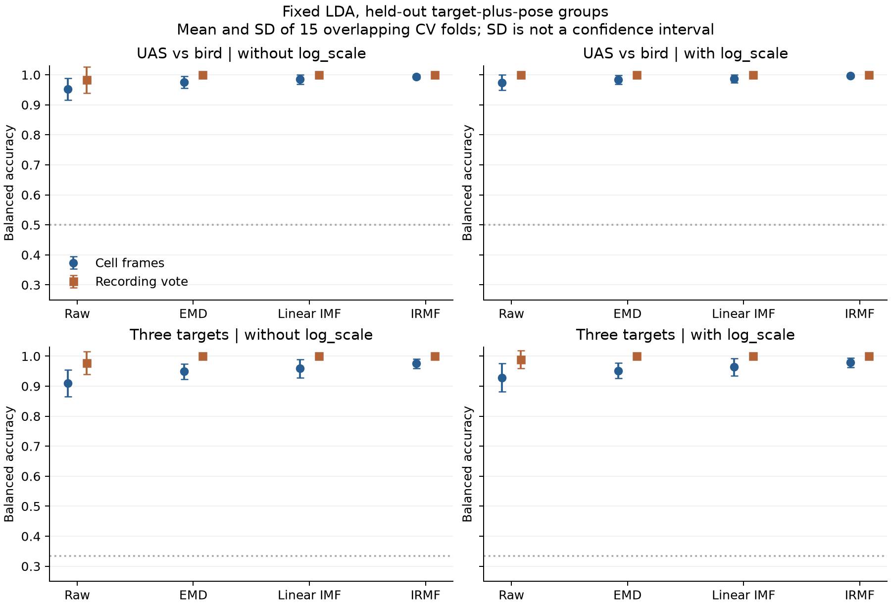
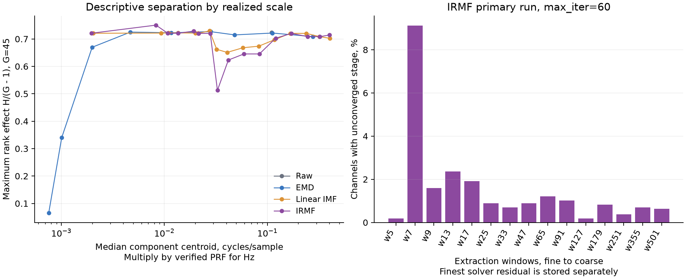

# UAS versus birds at 60 GHz: classical baselines

IRMF shows no established advantage on the primary UAS-versus-bird task: none of its six fixed-LDA comparisons passes the Holm-adjusted corrected t-test. The comparison uses the public moving-target subset and holds out target-plus-pose groups. All six classifiers ran in full mode on 5 folds x seeds 0, 1 and 2, for both tasks, both feature sets and all four methods. The numerical evidence below concerns this indoor bionic-bird campaign; it does not measure new-session or free-flight performance.

## Loader and representation

The nonexecuting pickletools scan found exactly three NumPy globals in all 98 files. The authorized isolated converter allowed only ndarray, dtype and reconstruct, including the NumPy 2 module alias. It rejected all other globals, persistent/extension mechanisms, object arrays and unsupported top-level types. Negative checks for os.system, builtins.eval, object arrays and arbitrary objects passed. No downloaded code ran. Each source was converted once; source/output SHA-256, dtype and shape are in the external manifest. A second conversion run reused hash-verified exports. Downstream preparation loads only allow_pickle=False arrays.

Each recording contributes its 16 cells with greatest within-recording complex dynamic variance. The cell's complex mean is removed; I and Q are the two channels. Stable cell-index tie breaking makes preparation deterministic. Labels play no role in cell selection. N=784, C=2, L=1000. The binary task has bird 320 and UAS 464 frames; the finer task has bird 320, Mavic 320, P3P 144. There are 49 recordings, 20/20/9 by target, and 45 CV groups, 18/18/9. Repeated bird settings and Mavic absorber variants at one pose share a group. Static targets, pole and the empty placeholder are excluded. Validation found no nonfinite, constant or zero-MAD channels.

An independent preparation rerun produced byte-identical frames.npy, meta.parquet and dataset.json. Hashes are saved in preparation_checks.json; loader checks are in loader_checks.json.

README.docx was read as ZIP/XML. It confirms sample and crop sizes but gives no PRF or flight IDs. The angle text files hold extracted signal phase, not flight metadata. The whole dataset is one indoor campaign. The sampling rate is unknown: fs=null, with the plot-based 1000 Hz hypothesis stored separately. Features remain in cycles/sample.

## Best balanced accuracy per method

Each row chooses the classifier with greatest mean outer-fold balanced accuracy, with exact ties resolved by alphabetical classifier name; macro-F1 and accuracy are for that same classifier. These winners are descriptive and optimistically selected from the outer results. They are not the basis for the paired superiority tests. comp excludes log_scale, comp+log_scale includes the shared I/Q amplitude-scale features. All imputing, scaling and tuning occurred inside training folds; tuning used grouped inner CV.

Raw has 40 component features, EMD 360, and each IMF method 640, plus two shared log_scale columns when requested. Feature dimension and classifier regularization can therefore contribute to differences. EMD has nine storage slots including padding/residue; the IMF methods have 16, including the finest solver residual.

### bird_drone

| feature_set    | method           | classifier   |   balanced_accuracy |   macro_f1 |   accuracy |
|:---------------|:-----------------|:-------------|--------------------:|-----------:|-----------:|
| comp           | emd              | linsvm       |              0.9760 |     0.9751 |     0.9759 |
| comp           | imf_linear_a1.41 | lda          |              0.9848 |     0.9855 |     0.9860 |
| comp           | irmf_h2_a1.41    | lda          |              0.9932 |     0.9934 |     0.9937 |
| comp           | raw              | linsvm       |              0.9653 |     0.9646 |     0.9658 |
| comp+log_scale | emd              | lda          |              0.9839 |     0.9845 |     0.9850 |
| comp+log_scale | imf_linear_a1.41 | lda          |              0.9871 |     0.9876 |     0.9881 |
| comp+log_scale | irmf_h2_a1.41    | lda          |              0.9962 |     0.9961 |     0.9962 |
| comp+log_scale | raw              | linsvm       |              0.9769 |     0.9762 |     0.9769 |

### target3

| feature_set    | method           | classifier   |   balanced_accuracy |   macro_f1 |   accuracy |
|:---------------|:-----------------|:-------------|--------------------:|-----------:|-----------:|
| comp           | emd              | lda          |              0.9493 |     0.9417 |     0.9533 |
| comp           | imf_linear_a1.41 | lda          |              0.9587 |     0.9521 |     0.9615 |
| comp           | irmf_h2_a1.41    | lda          |              0.9757 |     0.9719 |     0.9773 |
| comp           | raw              | logreg       |              0.9111 |     0.9060 |     0.9229 |
| comp+log_scale | emd              | lda          |              0.9514 |     0.9452 |     0.9564 |
| comp+log_scale | imf_linear_a1.41 | lda          |              0.9635 |     0.9587 |     0.9675 |
| comp+log_scale | irmf_h2_a1.41    | lda          |              0.9785 |     0.9748 |     0.9795 |
| comp+log_scale | raw              | logreg       |              0.9340 |     0.9304 |     0.9433 |

## Paired method verdicts

LDA is held fixed across methods and was chosen as the reporting classifier before viewing scores. Tables give A minus B, with a 95% Nadeau-Bengio corrected resampled interval. The corrected t-test is primary; Wilcoxon is secondary and optimistic on overlapping folds. Holm correction covers all 12 comparisons in each task/metric table, six pairs times two feature sets. The two-sided 0.05 threshold applies to p_nb_holm. The intervals are marginal, not simultaneous. Separate all-classifier CSVs apply Holm over 72 comparisons per task/metric. They include balanced accuracy, macro-F1 and accuracy, including comparisons omitted by the shared runner's default BA/F1-only export.

### bird_drone, frame-level balanced accuracy

| feature_set    | method_a         | method_b         | difference_95ci         |   p_nb_holm |   p_wilcoxon_holm |
|:---------------|:-----------------|:-----------------|:------------------------|------------:|------------------:|
| comp           | irmf_h2_a1.41    | emd              | +0.017 [-0.004, +0.039] |      1      |           0.03524 |
| comp           | irmf_h2_a1.41    | imf_linear_a1.41 | +0.008 [-0.006, +0.023] |      1      |           0.0807  |
| comp           | imf_linear_a1.41 | emd              | +0.009 [-0.007, +0.026] |      1      |           0.0807  |
| comp           | irmf_h2_a1.41    | raw              | +0.040 [-0.003, +0.084] |      0.7871 |           0.02133 |
| comp           | imf_linear_a1.41 | raw              | +0.032 [-0.010, +0.074] |      1      |           0.05273 |
| comp           | emd              | raw              | +0.023 [-0.010, +0.055] |      1      |           0.0807  |
| comp+log_scale | irmf_h2_a1.41    | emd              | +0.012 [-0.004, +0.028] |      1      |           0.05273 |
| comp+log_scale | irmf_h2_a1.41    | imf_linear_a1.41 | +0.009 [-0.005, +0.023] |      1      |           0.06836 |
| comp+log_scale | imf_linear_a1.41 | emd              | +0.003 [-0.010, +0.016] |      1      |           0.3164  |
| comp+log_scale | irmf_h2_a1.41    | raw              | +0.022 [-0.006, +0.050] |      1      |           0.03223 |
| comp+log_scale | imf_linear_a1.41 | raw              | +0.013 [-0.009, +0.035] |      1      |           0.0807  |
| comp+log_scale | emd              | raw              | +0.010 [-0.011, +0.030] |      1      |           0.1133  |

### target3, frame-level balanced accuracy

| feature_set    | method_a         | method_b         | difference_95ci         |   p_nb_holm |   p_wilcoxon_holm |
|:---------------|:-----------------|:-----------------|:------------------------|------------:|------------------:|
| comp           | irmf_h2_a1.41    | emd              | +0.026 [-0.004, +0.056] |     0.7236  |           0.02037 |
| comp           | irmf_h2_a1.41    | imf_linear_a1.41 | +0.017 [-0.011, +0.045] |     1       |           0.04102 |
| comp           | imf_linear_a1.41 | emd              | +0.009 [-0.034, +0.052] |     1       |           0.396   |
| comp           | irmf_h2_a1.41    | raw              | +0.066 [+0.024, +0.107] |     0.05311 |           0.00715 |
| comp           | imf_linear_a1.41 | raw              | +0.049 [-0.000, +0.098] |     0.5149  |           0.01323 |
| comp           | emd              | raw              | +0.039 [-0.016, +0.095] |     1       |           0.04551 |
| comp+log_scale | irmf_h2_a1.41    | emd              | +0.027 [-0.004, +0.058] |     0.7236  |           0.01758 |
| comp+log_scale | irmf_h2_a1.41    | imf_linear_a1.41 | +0.015 [-0.012, +0.042] |     1       |           0.04551 |
| comp+log_scale | imf_linear_a1.41 | emd              | +0.012 [-0.034, +0.058] |     1       |           0.396   |
| comp+log_scale | irmf_h2_a1.41    | raw              | +0.050 [+0.003, +0.096] |     0.4257  |           0.00293 |
| comp+log_scale | imf_linear_a1.41 | raw              | +0.035 [-0.016, +0.086] |     1       |           0.04551 |
| comp+log_scale | emd              | raw              | +0.023 [-0.028, +0.073] |     1       |           0.1641  |

### IRMF interpretation

| task       | feature_set    | against          |   mean_difference |   ci_low |   ci_high |   p_nb_holm | verdict      |
|:-----------|:---------------|:-----------------|------------------:|---------:|----------:|------------:|:-------------|
| bird_drone | comp           | emd              |            0.0175 |  -0.0038 |    0.0388 |      1.0000 | inconclusive |
| bird_drone | comp           | imf_linear_a1.41 |            0.0083 |  -0.0063 |    0.0230 |      1.0000 | inconclusive |
| bird_drone | comp           | raw              |            0.0403 |  -0.0030 |    0.0837 |      0.7871 | inconclusive |
| bird_drone | comp+log_scale | emd              |            0.0123 |  -0.0037 |    0.0282 |      1.0000 | inconclusive |
| bird_drone | comp+log_scale | imf_linear_a1.41 |            0.0091 |  -0.0052 |    0.0234 |      1.0000 | inconclusive |
| bird_drone | comp+log_scale | raw              |            0.0220 |  -0.0062 |    0.0503 |      1.0000 | inconclusive |
| target3    | comp           | emd              |            0.0264 |  -0.0037 |    0.0565 |      0.7236 | inconclusive |
| target3    | comp           | imf_linear_a1.41 |            0.0170 |  -0.0115 |    0.0455 |      1.0000 | inconclusive |
| target3    | comp           | raw              |            0.0656 |   0.0241 |    0.1072 |      0.0531 | inconclusive |
| target3    | comp+log_scale | emd              |            0.0271 |  -0.0037 |    0.0579 |      0.7236 | inconclusive |
| target3    | comp+log_scale | imf_linear_a1.41 |            0.0149 |  -0.0123 |    0.0421 |      1.0000 | inconclusive |
| target3    | comp+log_scale | raw              |            0.0497 |   0.0030 |    0.0963 |      0.4257 | inconclusive |

A nonsignificant test does not establish equality. Differences that depend on classifier choice or log_scale are not a universal decomposition advantage. Some secondary Wilcoxon comparisons pass Holm, including IRMF versus EMD without log_scale on the primary task. They do not overturn the corrected t-test verdict because these repeated folds overlap.



Figure 1. Fixed LDA, frame scores and recording-majority scores. Error bars show fold SD, not independent-sample uncertainty or confidence intervals.

## Recording-level aggregation

Within each held-out recording, the 16 cell predictions vote once. Ties use the alphabetically first label; this was deterministic and used no test truth. Recordings retain their original grouped split. A setting with three correlated recordings still belongs to one pose group. Corrected-test train/test ratios use pose-group counts. The following table holds LDA fixed; CSVs contain all classifiers, three metrics and paired tests. This is a prediction aggregation, not a separately trained recording model.

EMD, linear IMF and IRMF all reach 1.0 balanced accuracy after recording voting, on both tasks and both feature sets. This ceiling leaves no observed recording-level advantage for IRMF and limits what this subset can tell us about decomposition quality.

### bird_drone, recording vote

| feature_set    | method           |   balanced_accuracy |   macro_f1 |   accuracy |
|:---------------|:-----------------|--------------------:|-----------:|-----------:|
| comp           | emd              |              1.0000 |     1.0000 |     1.0000 |
| comp           | imf_linear_a1.41 |              1.0000 |     1.0000 |     1.0000 |
| comp           | irmf_h2_a1.41    |              1.0000 |     1.0000 |     1.0000 |
| comp           | raw              |              0.9833 |     0.9844 |     0.9852 |
| comp+log_scale | emd              |              1.0000 |     1.0000 |     1.0000 |
| comp+log_scale | imf_linear_a1.41 |              1.0000 |     1.0000 |     1.0000 |
| comp+log_scale | irmf_h2_a1.41    |              1.0000 |     1.0000 |     1.0000 |
| comp+log_scale | raw              |              1.0000 |     1.0000 |     1.0000 |

| feature_set    | method_a         | method_b         | difference_95ci         |   p_nb_holm |   p_wilcoxon_holm |
|:---------------|:-----------------|:-----------------|:------------------------|------------:|------------------:|
| comp           | irmf_h2_a1.41    | emd              | +0.000 [+0.000, +0.000] |           1 |                 1 |
| comp           | irmf_h2_a1.41    | imf_linear_a1.41 | +0.000 [+0.000, +0.000] |           1 |                 1 |
| comp           | imf_linear_a1.41 | emd              | +0.000 [+0.000, +0.000] |           1 |                 1 |
| comp           | irmf_h2_a1.41    | raw              | +0.017 [-0.036, +0.070] |           1 |                 1 |
| comp           | imf_linear_a1.41 | raw              | +0.017 [-0.036, +0.070] |           1 |                 1 |
| comp           | emd              | raw              | +0.017 [-0.036, +0.070] |           1 |                 1 |
| comp+log_scale | irmf_h2_a1.41    | emd              | +0.000 [+0.000, +0.000] |           1 |                 1 |
| comp+log_scale | irmf_h2_a1.41    | imf_linear_a1.41 | +0.000 [+0.000, +0.000] |           1 |                 1 |
| comp+log_scale | imf_linear_a1.41 | emd              | +0.000 [+0.000, +0.000] |           1 |                 1 |
| comp+log_scale | irmf_h2_a1.41    | raw              | +0.000 [+0.000, +0.000] |           1 |                 1 |
| comp+log_scale | imf_linear_a1.41 | raw              | +0.000 [+0.000, +0.000] |           1 |                 1 |
| comp+log_scale | emd              | raw              | +0.000 [+0.000, +0.000] |           1 |                 1 |

Across all classifiers and feature sets, 15 recording votes were tied out of 7056 votes. Each recording appears once per seed and model.

### target3, recording vote

| feature_set    | method           |   balanced_accuracy |   macro_f1 |   accuracy |
|:---------------|:-----------------|--------------------:|-----------:|-----------:|
| comp           | emd              |              1.0000 |     1.0000 |     1.0000 |
| comp           | imf_linear_a1.41 |              1.0000 |     1.0000 |     1.0000 |
| comp           | irmf_h2_a1.41    |              1.0000 |     1.0000 |     1.0000 |
| comp           | raw              |              0.9778 |     0.9636 |     0.9719 |
| comp+log_scale | emd              |              1.0000 |     1.0000 |     1.0000 |
| comp+log_scale | imf_linear_a1.41 |              1.0000 |     1.0000 |     1.0000 |
| comp+log_scale | irmf_h2_a1.41    |              1.0000 |     1.0000 |     1.0000 |
| comp+log_scale | raw              |              0.9889 |     0.9818 |     0.9859 |

| feature_set    | method_a         | method_b         | difference_95ci         |   p_nb_holm |   p_wilcoxon_holm |
|:---------------|:-----------------|:-----------------|:------------------------|------------:|------------------:|
| comp           | irmf_h2_a1.41    | emd              | +0.000 [+0.000, +0.000] |           1 |                 1 |
| comp           | irmf_h2_a1.41    | imf_linear_a1.41 | +0.000 [+0.000, +0.000] |           1 |                 1 |
| comp           | imf_linear_a1.41 | emd              | +0.000 [+0.000, +0.000] |           1 |                 1 |
| comp           | irmf_h2_a1.41    | raw              | +0.022 [-0.024, +0.068] |           1 |                 1 |
| comp           | imf_linear_a1.41 | raw              | +0.022 [-0.024, +0.068] |           1 |                 1 |
| comp           | emd              | raw              | +0.022 [-0.024, +0.068] |           1 |                 1 |
| comp+log_scale | irmf_h2_a1.41    | emd              | +0.000 [+0.000, +0.000] |           1 |                 1 |
| comp+log_scale | irmf_h2_a1.41    | imf_linear_a1.41 | +0.000 [+0.000, +0.000] |           1 |                 1 |
| comp+log_scale | imf_linear_a1.41 | emd              | +0.000 [+0.000, +0.000] |           1 |                 1 |
| comp+log_scale | irmf_h2_a1.41    | raw              | +0.011 [-0.024, +0.047] |           1 |                 1 |
| comp+log_scale | imf_linear_a1.41 | raw              | +0.011 [-0.024, +0.047] |           1 |                 1 |
| comp+log_scale | emd              | raw              | +0.011 [-0.024, +0.047] |           1 |                 1 |

Across all classifiers and feature sets, 17 recording votes were tied out of 7056 votes. Each recording appears once per seed and model.

## Discriminability by component scale

The shared runner exports frame-level Kruskal-Wallis and mutual information, but its frame p-values treat correlated cells as independent. The extra analysis first takes the median feature across all cells and recordings within each of 45 pose groups. The table below gives the three strongest component slots per method for each task. Rank effect is H/(G-1), the quantity named epsilon2 in the shared code. Mutual information uses the shared 16-bin, bias-corrected estimator. These are all-data descriptive rankings, never training-time feature selectors. Group-feature KW p-values have Holm correction over every feature and method within a task in discriminability_pose_groups.csv.

### bird_drone, strongest component scales

| method           | slot_label   | top_feature          |   max_rank_effect |   max_mi |   centroid_cycles_per_sample |
|:-----------------|:-------------|:---------------------|------------------:|---------:|-----------------------------:|
| irmf_h2_a1.41    | w355         | ch1_c13_spec_peak    |            0.7505 |   0.6841 |                       0.0083 |
| imf_linear_a1.41 | w65          | ch1_c8_zcr           |            0.7295 |   0.6841 |                       0.0274 |
| irmf_h2_a1.41    | w127         | ch0_c10_zcr          |            0.7288 |   0.6306 |                       0.0193 |
| emd              | imf4         | ch0_c3_spec_peak     |            0.7268 |   0.6306 |                       0.0280 |
| emd              | imf6         | ch1_c5_zcr           |            0.7251 |   0.6306 |                       0.0047 |
| raw              | frame        | ch0_c0_spec_peak     |            0.7233 |   0.6306 |                       0.1100 |
| emd              | imf5         | ch0_c4_zcr           |            0.7225 |   0.6422 |                       0.0116 |
| imf_linear_a1.41 | w251         | ch0_c12_extrema_rate |            0.7223 |   0.6841 |                       0.0109 |
| imf_linear_a1.41 | w179         | ch0_c11_extrema_rate |            0.7221 |   0.6306 |                       0.0136 |
| irmf_h2_a1.41    | w501         | ch1_c14_extrema_rate |            0.7208 |   0.6306 |                       0.0020 |

### target3, strongest component scales

| method           | slot_label   | top_feature          |   max_rank_effect |   max_mi |   centroid_cycles_per_sample |
|:-----------------|:-------------|:---------------------|------------------:|---------:|-----------------------------:|
| imf_linear_a1.41 | w65          | ch1_c8_zcr           |            0.8754 |   1.0771 |                       0.0274 |
| irmf_h2_a1.41    | w65          | ch0_c8_zcr           |            0.8675 |   1.0352 |                       0.0279 |
| imf_linear_a1.41 | w91          | ch0_c9_extrema_rate  |            0.8649 |   0.9701 |                       0.0213 |
| imf_linear_a1.41 | w179         | ch0_c11_extrema_rate |            0.8648 |   0.9701 |                       0.0136 |
| irmf_h2_a1.41    | w355         | ch0_c13_hjorth_cpx   |            0.8644 |   0.9817 |                       0.0083 |
| irmf_h2_a1.41    | w179         | ch0_c11_energy_frac  |            0.8644 |   0.9701 |                       0.0136 |
| raw              | frame        | ch1_c0_spec_centroid |            0.8609 |   0.9817 |                       0.1100 |
| emd              | imf5         | ch0_c4_spec_entropy  |            0.8609 |   0.9701 |                       0.0116 |
| emd              | imf2         | ch0_c1_spec_centroid |            0.8540 |   0.9817 |                       0.1120 |
| emd              | imf1         | ch0_c0_energy_frac   |            0.8363 |   0.9165 |                       0.2768 |

### Shared amplitude scale

| task       | method           |   channel |   epsilon2 |     mi |   kw_p_holm |
|:-----------|:-----------------|----------:|-----------:|-------:|------------:|
| bird_drone | raw              |         0 |     0.5177 | 0.3326 |    0.001699 |
| bird_drone | raw              |         1 |     0.3909 | 0.3209 |    0.02431  |
| target3    | raw              |         0 |     0.5697 | 0.5347 |    0.002714 |
| target3    | raw              |         1 |     0.4914 | 0.4927 |    0.01237  |
| bird_drone | emd              |         0 |     0.5177 | 0.3326 |    0.001699 |
| bird_drone | emd              |         1 |     0.3909 | 0.3209 |    0.02431  |
| target3    | emd              |         0 |     0.5697 | 0.5347 |    0.002714 |
| target3    | emd              |         1 |     0.4914 | 0.4927 |    0.01237  |
| bird_drone | imf_linear_a1.41 |         0 |     0.5177 | 0.3326 |    0.001699 |
| bird_drone | imf_linear_a1.41 |         1 |     0.3909 | 0.3209 |    0.02431  |
| target3    | imf_linear_a1.41 |         0 |     0.5697 | 0.5347 |    0.002714 |
| target3    | imf_linear_a1.41 |         1 |     0.4914 | 0.4927 |    0.01237  |
| bird_drone | irmf_h2_a1.41    |         0 |     0.5177 | 0.3326 |    0.001699 |
| bird_drone | irmf_h2_a1.41    |         1 |     0.3909 | 0.3209 |    0.02431  |
| target3    | irmf_h2_a1.41    |         0 |     0.5697 | 0.5347 |    0.002714 |
| target3    | irmf_h2_a1.41    |         1 |     0.4914 | 0.4927 |    0.01237  |

The component centroid measures absolute slow-time spectral frequency, not signed radial motion, because I and Q are decomposed separately. Fine residuals and short windows describe rapid fluctuations, while long windows describe slower modulation. EMD's IMF order is data-adaptive; window size is not a Doppler passband. The realized centroids in component_scales.csv provide the comparison in cycles/sample. Only if PRF is verified as 1000 Hz can these centroids be multiplied by 1000 for Hz; at 60 GHz, v=0.0025 f_D m/s for monostatic Doppler. Aliasing and unknown PRF rule out identifying blade velocities. IMF residual_fine is the finest slot, not a coarse trend.

Separation is spread across many component scales and is already strong in raw spectral features. Both IMF methods have strong three-target separation at w65, with realized centroids near 0.027-0.028 cycles/sample. There is no isolated IRMF-only Doppler band established by this descriptive analysis. log_scale itself separates the groups, so amplitude and acquisition conditions remain a plausible contributor to the scores.



Figure 2. Left: descriptive group-level rank separation versus realized spectral scale on the primary task. Maximum-over-features values have selection optimism. Right: primary IRMF stage nonconvergence, over 1568 channels.

## Compute, reconstruction and convergence

| method           |   slots |   failed_channels |   cpu_seconds_per_frame |   run_wall_seconds |   max_abs_reconstruction_error |
|:-----------------|--------:|------------------:|------------------------:|-------------------:|-------------------------------:|
| emd              |       9 |                 0 |              0.0304706  |           10.6788  |                    1.52265e-06 |
| imf_linear_a1.41 |      16 |                 0 |              0.00442059 |            2.81671 |                    8.39899e-07 |
| irmf_h2_a1.41    |      16 |                 0 |              0.354721   |          106.923   |                    1.67923e-06 |

IRMF converged at every stage in 1374/1568 channels. There were 355 unconverged stages out of 23520, affecting 126/784 frames. The w7 stage missed convergence in 143 channels, 9.12%, the highest rate.

|   slot | slot_label   |   unconverged |   fraction_unconverged |   mean_iterations |
|-------:|:-------------|--------------:|-----------------------:|------------------:|
|      0 | w5           |             3 |                0.00191 |          10.14796 |
|      1 | w7           |           143 |                0.09120 |          18.76658 |
|      2 | w9           |            25 |                0.01594 |          17.81250 |
|      3 | w13          |            37 |                0.02360 |          17.71301 |
|      4 | w17          |            30 |                0.01913 |          17.30293 |
|      5 | w25          |            14 |                0.00893 |          17.62883 |
|      6 | w33          |            11 |                0.00702 |          18.30740 |
|      7 | w47          |            14 |                0.00893 |          18.89605 |
|      8 | w65          |            19 |                0.01212 |          18.68686 |
|      9 | w91          |            16 |                0.01020 |          18.26020 |
|     10 | w127         |             3 |                0.00191 |          18.12245 |
|     11 | w179         |            13 |                0.00829 |          17.62564 |
|     12 | w251         |             6 |                0.00383 |          16.83610 |
|     13 | w355         |            11 |                0.00702 |          16.75000 |
|     14 | w501         |            10 |                0.00638 |          16.23214 |

CPU seconds per frame include both I and Q. Every channel was finite and reconstructed the normalized input within the displayed float32 error. Primary IRMF kept lookup=True, max_iter=60 and tol=1e-6. An unconverged stage still contributes a partial estimate and the residual preserves reconstruction; exact reconstruction does not establish solver convergence. A fully converged classification sensitivity run has not been performed, so the verdict is about the package-default feature extractor.

## Comparison with published protocols

The authors' [CNN code](https://github.com/sk8053/drone_bird_detection_with_radar/blob/0e991a1b99f8eac2acab420254f656dc434d7f38/drone_bird_classification_with_convnet.py) concatenates recordings, normalizes by each known class's maximum over the full data, randomly permutes time samples, then makes a 70/30 train/validation split. This shares recordings and fitted normalization information across partitions. The [ConvLSTM code](https://github.com/sk8053/drone_bird_detection_with_radar/blob/0e991a1b99f8eac2acab420254f656dc434d7f38/drone_bird_classification_with_conv_lstm.py) forms overlapping five-sample windows before permuting and splitting 30/70. Neighboring windows can share raw samples across partitions. Our inference from that code is that those protocols estimate within-recording interpolation. Their near-99% results described in the dataset notes do not establish performance on unseen recordings. We did not rerun the leaky neural protocols or treat their accuracy as a paired baseline.

[Larrat and Sales, 2025](https://doi.org/10.3390/s25030721) report Transformer white-noise AUCs of 0.97/0.92/0.98 for bird/Mavic/P3P; those are one-vs-rest AUCs, not balanced accuracy. Their random validation protocol described in the dataset notes supplies no recording-held-out guarantee. Task subsets, signal representations, metrics and noise conditions differ, so our numbers cannot establish superiority over those publications.

## Statistical power and limits

There are at most 45 conservative pose units, and just nine P3P units, all from one campaign. Repeating five-fold CV three times does not produce 15 independent experiments or turn 784 correlated cells into independent samples. The corrected standard error is sqrt((1/15 + mean(n_test/n_train)) * variance_of_paired_differences), about 2.18 times the naive fold standard error when the ratio is 1/4. A typical test fold has about nine pose groups and only one or two P3P groups. Small improvements have low power; absence of significance is not equivalence. Every outer training and test partition contained all classes; the saved split audit verifies group and recording separation. No independent-session power claim is possible.

Background, absorber configuration, target identity and mount remain potential confounds. Selection is label-free, but the strongest dynamic cells are not verified physical wing or rotor cells. A target-free background control and a max_iter convergence sensitivity would help separate mechanism from campaign artifacts. The full DataPort cubes may supply background context and PRF metadata, but may repeat the same recordings; only new verified recordings or sessions would add independent statistical power.

## Reproduce and inspect

Code is confined to datasets/uas_birds_60ghz/. Numeric data, converted cubes, feature caches, shared split files and out-of-fold predictions remain outside the repository. Small CSV/JSON tables, the two PNG figures and this report live here. No commit was made. The untested full-release input contract is documented in the dataset README.

```bash
cd /Users/mikhail/.t3/worktrees/imf/t3-44ed3594/experiments/classification-emd-irmf
../../.venv/bin/python -m emdirmf.validate uas_birds_60ghz
../../.venv/bin/python -m emdirmf.run_decompose --dataset uas_birds_60ghz --method emd imf_linear_a1.41 irmf_h2_a1.41 --workers 3
../../.venv/bin/python -m emdirmf.run_features --dataset uas_birds_60ghz --method raw emd imf_linear_a1.41 irmf_h2_a1.41 --workers 3
../../.venv/bin/python baselines/run_classical.py --dataset uas_birds_60ghz --task bird_drone --workers 3
../../.venv/bin/python baselines/run_classical.py --dataset uas_birds_60ghz --task target3 --workers 3
../../.venv/bin/python datasets/uas_birds_60ghz/analyze_classical.py
```
